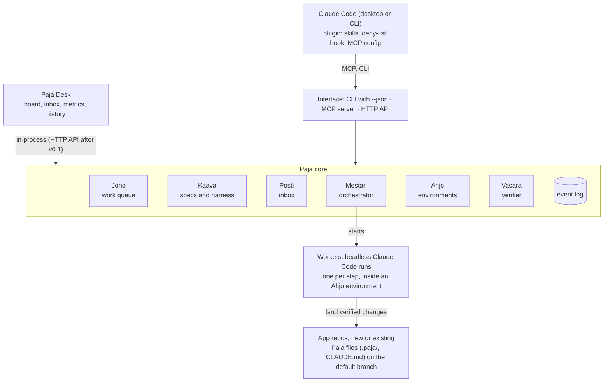

# Architecture

One headless core, Paja, with Claude Code and Paja Desk as two doors into it. The front ends never talk to each other,
only to the core, so either can be added, replaced or left out. Claude Code appears twice on purpose: once as a front
end a person types into, and once as the worker that Mestari starts on its own.

## Units

| Unit | Job | First version built with |
| --- | --- | --- |
| **Ahjo** (environments) | An isolated environment per chunk: git worktree, ports, database, services, seed data. Each one sandboxed and failing closed (no run if the sandbox can't start, hooks block when they fail), with a GitHub token that reaches only the repository being worked on | git worktrees, Docker Compose |
| **Jono** (queue and scheduler) | Work items with dependencies (`Depends on #N`); lease each chunk to one worker; pick the next one with plain rules; enforce a diff-size budget per chunk; pace work to the account's usage limits | GitHub issues with the work label (`.paja/labels`, `paja` in this repository), event log |
| **Kaava** (specs and harness) | Versioned specs with acceptance criteria and a risk tier; held-out scenarios the builder never sees; an eval suite of real chunks that tests the harness itself; the domain harness and canon rules, the `CLAUDE.md` and skills each environment reads from the project's default branch rather than from outside the repository | Markdown in the repo |
| **Mestari** (orchestrator) | Run workflow graphs: spec, plan, build, verify, review, land, post-land verify. Fix loops are capped at three rounds, after which the builder rethinks the approach instead of patching. Planner, builder, reviewer and evaluator are separate roles. A learn step after landing drafts harness rules from failures | YAML graphs; `claude -p` subprocesses |
| **Vasara** (verifier) | Load rules and scenarios from the default branch, never from the branch under review; boot the environment and run deterministic and end-to-end checks; an independent, skeptical evaluator agent grades the running app against the acceptance criteria and held-out scenarios; after landing, re-run on `main` and revert on failure | The app's own test commands, Playwright |
| **Posti** (inbox) | Collect every agent question and escalation; send one digest, each item with options and a recommendation; mirror status to the issue | Issue comments, event log |
| Interface | One set of core functions exposed three ways, all reading from the event log | CLI (`paja ... --json`), MCP server (official Rust MCP SDK), HTTP API |
| Claude Code plugin | `plugin/`: the MCP server config (`paja mcp`) and the skills `/paja:status` (the queue, latest events, open questions), `/paja:answer` (answer an escalation and requeue it) and `/paja:spec` (turn a conversation into a `paja` issue after the person approves it). The skills change Paja's state only through its MCP tools. Agents Mestari starts load no plugins; their deny-list hook is set by Mestari itself | Claude Code plugin, installed from this repository's marketplace |
| **Paja Desk** | Board of chunks, Posti inbox, outcome metrics, spend and history, usable from a phone | Desktop app (Tauri 2) calling the core in-process; the HTTP API, for the phone, comes after v0.1 |

## State

The event log is the only store. It is append-only JSON lines in `$PAJA_HOME/events.jsonl`; every part derives its
current state by replaying it, and every write holds the home lock. See `crates/paja/src/events.rs`.

A write cut off by a crash leaves bytes after the last newline. Those were never acknowledged, so the next append
cuts them off and keeps them in `events.jsonl.torn`; a bad line that ends in a newline is an error, never repaired.

One home serves many repositories. Every `work.*` and `run.*` event about an item carries `"repo"`, the repository as
`owner/name` (from `gh repo view --json nameWithOwner` in the checkout), so an item is keyed by repository and issue
number. (`run.tampered` and `run.tamper_checked` are about a checkout and use `repo` for its git directory; the first
also carries `work_repo`, so the queue stays readable there without running gh.) Logs written before that stay readable
because replay migrates them and nothing is rewritten: an event without a repository belongs to the repository of the
first `work.*` event that names one (the first `paja work sync` the log records), or, when none does yet, to the
repository of the checkout the command runs in. The first write from a repository to a log that still holds such older
events appends a `work.synced` event naming it, so a later command from another checkout can't move them.

## Work queue

Jono's items are GitHub issues with the work label (`.paja/labels`, `paja` in this repository), each belonging to a
repository. `.paja/labels`, read from the default branch like `.paja/checks` and never from the branch under review, has
up to three lines: `work <label>`, which Jono imports, `follow-up <label>`, which Jono imports after the work label
(people file these; Mestari files none), and `needs-answer <label>`, which marks an escalated item's issue until
`paja work answer` requeues it. Without the file they are `factory`, `factory-follow-up` and `factory-needs-answer`;
this repository keeps `paja` and `paja-follow-up`. The three must differ. A file that doesn't read stops a sync with an
error that names the line; `paja work answer` still records and posts the answer, removes the default
`factory-needs-answer` and says on stderr that it did. Changing the work label closes the queue as it was: the next sync
no longer sees issues with the old label and closes every item it imported with it. `.paja/labels` takes effect only
once its change lands on the default branch, so add the new label to the open issues before it lands, keeping the old
one, and remove the old label after: every sync in between sees them under one label or the other. `paja work sync`
reads the open ones of the checkout's repository with `gh` and appends `work.imported`, `work.changed`, `work.closed`
and `work.reopened` events, plus `work.checkout` (`repo`, `path`) when it runs in another checkout than the last one
recorded, as the file system resolves them (a symlink or a Windows short name to the same folder is the same checkout)
(every `paja run` syncs first, so runs record it too); it never touches another repository's items, even when their
issue numbers are the same. Each sync also frees the environments of closed, parked (escalated) items whose issue GitHub
says is closed: it removes the item's Ahjo environment (its hashed name, or the `work-<n>` an older release made, when
the log shows the item last ran there) if it was made in this checkout, keeping the branch, and lists it under `freed`,
since nothing else frees the worktree and port block of an item closed instead of answered. A reopened item resumes from
the kept branch: its own, else `paja/work-<n>`, renamed to its own (see `paja run` below). An environment is kept,
listed under `kept` with the reason and tried again by the next sync, when the issue is still open (its label changed,
or `follow-ups = off` hides it), when a run holds the item or the item is no longer closed and parked once the home lock
is taken for the removal (`ahjo::remove_unless` decides under the same lock as the removal), when the worktree folder is
already gone (removing it would prune every missing worktree of the repository), when the worktree isn't on the
environment's branch or git can't read its HEAD, or when git refuses: uncommitted changes, untracked files, a locked
worktree or submodules. One removed meanwhile by another sync or `paja env remove` is in neither list. Ignored files,
such as build output or a local `.env`, go with the worktree. `paja run` prints what its sync freed and kept on stderr.
`paja work list|show|next|claim|answer|set`, `paja run` and the matching MCP tools act on the repository of the checkout
they run in (`--repo`, default the current directory); `paja work list --all` lists every repository's items, each with
its `repo`, and works outside a checkout unless the log still holds events from before items carried a repository and no
`work.*` event names one yet. Whether an issue is open is kept apart from the item's status (`queued`, `active`,
`landed`, `escalated`, set with `work.status`), so an escalation's question survives the issue closing and reopening; a
landed issue that reopens is queued again. `paja work claim` takes the oldest open, queued item that waits on nothing
and marks it active under the home lock, so two runs never share one.

Several runners can share one queue, because a claim is written on GitHub where every runner reads it. The first time a
home claims anything it records a random runner id (`runner.created`); the id names no host or user, since the
repository may be public. `paja run` claims an item by adding the label `<work label>-claimed` (`paja-claimed` for
`paja`; created when the repository lacks it) and posting one comment, `Claimed by runner <id> at <UTC time>; stale
after <time>`, six hours on. It then reads the issue again. Every reader of a race goes by one rule: the first live
claim comment wins. If another runner's live claim comment is ahead of its own, that runner won, so the run deletes its
own comment and tries the next item. If its own comment is gone (a runner giving the item back deleted it as a later
claim) it lost too, and leaves the item, taking the label off unless another runner's live claim is on the issue. When
it lost to another runner the label stays: it is shared, and it now marks the winner's claim (taking it off would make
the item look free until the winner's next renewal). When `gh` can't write the claim the item is not taken, and the
run's error says why. The run deletes its comment if posted, and takes the label off unless another runner's live claim
is on the issue (or the issue can't be read). Every sync reads the claimed label with the other labels, and for each
issue that carries it the first live claim comment (the race's winner; else the latest), and records what changed as
`work.claim` (`runner`, `stale_after`; `runner` is null once the label is gone). An item whose label names another
runner is skipped by `paja run` and by `paja run --workers` until that claim is stale; `paja work list|show` show the
holder as `claim`, and `paja pool status` gives "claimed by runner <id> on GitHub" as why the item waits. A label with
no claim comment (put there by hand) holds the item until a person removes it. A run renews its claim at each round by
editing its claim comment's times (and putting the label back if it was taken off). A claim that went stale is posted
again and the old comment deleted: edited, it would keep its early place in comment order and win the race back from a
claim posted while it was stale. If another runner claimed the item while the claim was stale, the run doesn't renew it
and says on stderr that the other runner holds the item. `paja work set N queued` deletes every live claim comment,
whichever runner wrote it, and takes the label off: the person put the item back, which overrides the holder. A run that
gives back an item it claimed (the person declined at the confirmation, or a gate put it back) deletes its own runner's
live claim comments and the later ones that lost the race to it, and takes the label off unless an earlier runner's live
claim remains. Either way a claim comment GitHub refuses to delete (another account wrote it) doesn't stop the rest: the
label still comes off (or stays, as above), and stderr names the comment to delete by hand. Until it is deleted, or goes
stale, that comment wins every race; runners that lose to it leave the label on, so `paja work list` names its runner as
the holder. An escalated item keeps its claim, which can't go stale while it carries the needs-answer label. `paja work
answer` renews the claim, so the runner that escalated the item runs it next.

When no work item is ready, Jono takes follow-ups. A sync also imports the open issues with the follow-up label as items
whose `priority` is `follow-up` (recorded in `work.imported` and `work.changed`; every other item has priority `work`).
An issue with both labels is a work item. `paja work list`, `work next`, `work claim`, `paja run` and the MCP tools order
the queue by priority and then age, so every ready work item goes before any follow-up, and a work item that becomes
ready wins at the next pick. A follow-up passes through the same loop, risk tier and `Depends on` rules as any item.
`.paja/queue`, read from the default branch like `.paja/labels`, turns this off with `follow-ups = off` (`on` is the
default); a sync with it off doesn't list the follow-up label, so the follow-ups already imported close like any item
whose label went away. The sync asks GitHub whether each such issue is still open; the `work.closed` events of those
that are carry `follow_ups_off: true`, so when follow-ups come back on a follow-up that had landed stays landed instead
of being queued again like a reopened landing. One GitHub closed meanwhile closes like any item, and is queued again if
it reopens. When follow-ups come back on, each landed follow-up the rule hid is asked about once more: if the issue's
GitHub events show a reopen since it was hidden (closed and reopened in between, say after a revert), its
`work.reopened` carries `reopened_on_github: true` and it is queued again. If GitHub can't list the events, the sync
fails with that error and records nothing, so the next sync asks again. A line Jono can't read is an error naming the
line.

An issue declares what it needs first with a line in its body that starts with `Depends on` or `Blocked by`, followed by
issue numbers (`Depends on #12, #14`), after optional quote, list or number markers. Lines in fenced code blocks don't
count (an unclosed fence hides nothing), and neither do references to another repository (`other/repo#12`), which Jono
can't check. Each sync records a `work.waiting` event when the set of those still open changes: a dependency in the
queue is open until it closes or Paja lands it, and one outside the queue, an issue or a pull request (merged counts as
closed), is asked about with `gh api` (one that can't be read counts as open). A dependency Paja landed counts as done
until the same sync sees it reopened. An item with open dependencies is never claimed; `paja work list` shows them as
`waiting_on`, and `paja run` says which items wait on what when nothing else is ready, naming a dependency cycle as one
(`paja work list` names it too). An item imported before Jono read dependencies waits on every one its body names until
a sync judges it. A sync that reads its full limit of issues refuses to close anything rather than drop work it could
not see.

`paja work answer <issue> <text>` records a person's answer to an escalated item (`work.answered`, with the question it
answers) and queues the item again under the home lock, then posts the answer as a comment on the issue, made public like Paja's own comments: paths and tokens hidden, mentions made inert (an agent can write the answer too), and cut to fit. The log keeps the answer as given. Each item
keeps its `answers`, and every later run passes them to the builder and the reviewers, since agents can't read the
issue's comments; a reply on the issue alone doesn't reach them, and Paja's question on the issue says so. For the
same reason `paja work set <issue> queued` refuses an escalated item and points at `paja work answer`; it is the only
way an escalated item is queued again. Setting it `active` and then `queued` by hand still works, as a deliberate
escape hatch for an item that needs no answer.
`paja work file --title --body` opens a new issue with the work label. Both use `gh`, and the MCP tools `work_answer` and
`work_file` do the same.

## The run loop

Mestari's code is the `crates/paja/src/mestari/` module, split so that `.paja/high-risk` lists only what decides
what lands and how hard it is judged: `mod.rs` (the round loop, main's configuration, the risk tier, the review
prompt and verdicts), `agent.rs` (how agents are started: flags, hook settings, self-test, sandbox glue,
`GitGuard`), `arbiter.rs` (the arbiter that settles an escalation, and the rules that overrule it), `land.rs`
(landing, waiting for CI, escalation), `triage.rs` (`paja triage`) and `detect.rs` (the `init` agents' sandboxes and
tool lists). Outside the module, `init/generate.rs` (the programs a generated skeleton's agent may run) is high risk
too. Usage counting (`usage.rs`), stderr progress text (`progress.rs`), follow-ups (`follow_ups.rs`), the builder's
question and answers (`builder.rs`), where a run is (`live.rs`), the pool (`pool.rs`, `plan.rs`) and the rest of
`init/` are normal risk. A unit test walks every source file and fails on one that is neither on the list nor named
as normal risk on purpose.

`paja run` is Mestari's first graph. It reads the repository's default branch and allowed merge methods once from
`gh repo view`, fetches `origin/<default branch>`, syncs Jono, reads `.paja/checks`, `.paja/high-risk`, `.paja/models`
and `.paja/ci` from the default branch and checks them (`.paja/ci` is `required`, the default, or `none` for a
repository without CI; with `required` a repository with no GitHub Actions workflow stops the run before it claims
anything, once an item is ready to take, so nothing is claimed on GitHub (with the usage window nearly used, only an
item left active to resume counts, so a pass that pauses with only new items ready skips the check); with `none` landing
skips the CI wait and the pull request body says so), claims the next item of the checkout's repository and creates an
Ahjo environment named `<repo>-<hash>-work-<issue>` (the repository's name and a short hash of `owner/name`, so two
repositories' item #5 never share a worktree, branch or port block) from the default branch (resuming the branch an
earlier run kept). An item started before environments carried the repository's name resumes its old `work-<issue>`
environment when that was made in this checkout, or, once that environment is gone, its `paja/work-<issue>` branch,
which is renamed to the item's own so it is carried over once. The branch is the item's only when the log shows it: the
latest run in an environment named `work-<issue>` is the item's, and no run of the item landed after it. Otherwise, or
when a `work-<issue>` environment still holds it or a worktree has it checked out, the run says so and starts fresh. A
run that stops on an error removes the environment it used, but a `work-<issue>` only when it has no uncommitted
changes, since an older release's park may have kept the builder's edits there; one that belongs to another repository
is never taken, and a hashed name found to belong to another repository stops the run with the `paja env remove <name>`
fix. `paja env create` and the MCP tool refuse names of that shape (and the triage pass's `<repo>-<hash>-triage`, a
plan's `plan-<issue>` and the old `work-<issue>`), so Paja never reuses, resets or removes an environment a person made.
A mistake in that configuration stops the pass before it claims anything, with an error naming the file and line, so one
fix on the default branch is all it takes. That holds even when the queue is empty: the pass reports the error, not
`idle`. A `--every` loop reports it and tries again after its wait. While it works on an item the run holds an OS file
lock, `runs/<owner>@<name>@<issue>.lock` in the home, which the operating system releases however the process ends. An
item a `paja run` claimed (its status change carries `"run": true`) that is still `active` while its lock is free was
left by a run that stopped (Ctrl-C, a closed terminal, a reboot): the next pass resumes it first, in its environment,
and says so on stderr. The resumed run goes on in the round that was cut off ("resuming #5 in round 2: the review of
abc1234 was interrupted"), never past `MAX_ROUNDS` counted across all runs of the item. When the environment or its
branch is gone, the item starts again on a new branch with a build, but in the round it had reached ("resuming #5 in
round 2 on a new branch"), so the rounds already spent still count toward the cap. It rebuilds where it stood from every
run event of the item since it was last queued, claimed or answered, not only the last run's, so an item interrupted
again before it records a round keeps its round count and blockers: the round, the feedback for the builder, and the
reviewed commit, blockers and follow-ups the next review narrows itself to. When the checks passed on the branch's HEAD
(`run.checked`, with the default branch tip they ran against) and the worktree is clean, with no index flags, it skips
the build; if the default branch is also unchanged it skips the checks too and goes straight to the review. Any other
state builds and checks again. Items claimed with `paja work claim` are never taken over. Agents, Vasara's checks, git
and gh run in process groups of their own (Unix: a new process group; Windows: `CREATE_NEW_PROCESS_GROUP`), so the
terminal's Ctrl-C reaches only `paja`. The first Ctrl-C stops the run at the next step boundary (before a round's build,
the checks or the review; a change both reviewers passed still lands): the round's steps are recorded with verdict
`stopped`, the item stays active for the next run, and the run reports `{"outcome": "stopped"}`; `--every` stops its
loop too. Any error after a Ctrl-C ends the same way rather than parking the item, unless the repository was tampered
with. A second Ctrl-C ends the running agent or check with every process it started and stops at once. A program that
starts `paja run` without a terminal (Paja Desk) passes `--stop-on-stdin` and writes a `stop` or `stop now` line to its
stdin instead, which counts as the first or second Ctrl-C on every platform (the first stop's message then names
`stop now`, not a second Ctrl-C); stdin closing leaves the run going. A stdout nobody reads any more (that program
exited) loses the report but not the run: Paja doesn't panic on it, and the exit code still says how the run ended.

`paja run --every M --workers N` runs a pool of lanes (`crates/paja/src/mestari/pool.rs`). One process holds
`runs/<owner>@<name>@pool.lock`, so a repository has one pool, and keeps up to N lanes busy. Each lane is a `paja run
--item <issue>` of its own, in its own Ahjo environment, that skips the sync; the pool syncs Jono for all of them, at the
start, after a lane finishes and every M minutes while a lane is free. Every tick (half a second) it reads the lane
count, the latest `pool.lanes` event (`repo`, `lanes`), and hands each free lane the next item a run could take
(`jono::runnable`: items a stopped run left active first, then ready ones, never one a live run holds). `paja pool
lanes <N>` records a new count, which the running pool reads on its next tick: a higher one starts lanes then, and a
lower one lets running items finish and starts none until the busy lanes are under it. An item whose lane ended on an
error waits for the next timed sync, as `--every` waits after a failed pass; `paja pool status` gives that as the
item's reason for waiting, and keeps giving it after the sync, since the log doesn't record the sync, so the item may
then be waiting only for a free lane. The pool records `pool.started` (`repo`, `lanes`, `pid`), `pool.lane` (`repo`,
`lane`, `number`, `stage`, `step`) for every step a lane's run starts (`stage` is `starting`, `build`, `checks`,
`review`, `land`, then `done` with the run's `outcome`) and `pool.stopped`; `paja pool status` and its MCP tool
`pool_status` rebuild the pool from them and the lock alone: its `state` is `running` only while a live pool holds
`runs/<repo>@pool.lock` and no `pool.stopped` follows the latest `pool.started`, so a pool that was killed, which
records no `pool.stopped`, reads as stopped and shows no busy lanes. Ctrl-C or a `stop` line stops admitting and is
passed on to every lane's run, which finishes its step as one run does; the pool stops when the lanes have. A tamper
stop any lane's run records (`run.tampered` for the checkout) is seen on the next tick: every lane is told `stop
now`, none starts, and the pool ends with the tamper error, as `--every` would. A pool that ends on any other error
stops its lanes the same way first, and ends a lane's run still going 30 seconds after `stop now`, so a stuck run
can't hang the pool. Lanes fetch in the same checkout at once, so a run reads the default branch's tip
from a ref of its own fetch (`refs/paja/fetch/...`, deleted right after), never from `FETCH_HEAD` or
`origin/<branch>`, which every fetch there writes; `origin/<branch>` is then moved to that tip, as a plain fetch
would, also back after a force-push. The fetches in a checkout take turns (`paja-fetch.lock` in its git directory),
so the last to move it is the newest; a fetch that waited a minute for the lock goes ahead without it, and then never
moves it back onto a commit it holds. A fetch ref a killed run left behind is deleted by the first fetch in that
checkout once it is over an hour old.

Changes land one at a time per repository, each on the latest default branch, whether from a pool's lanes or from
runs started apart. A run whose reviewers say `land` first takes the repository's turn to land,
`runs/<owner>@<name>@land.lock`, under the home lock (`land::land_turn`), recording `pool.merging` (`repo`, `number`,
`round`) while another run holds it and `pool.landing` once it has it; it holds the turn through the push, the pull
request, CI and the merge, and lets go when the change lands or goes back to its builder. With the turn it merges the
latest default branch in again: when that branch moved on while it waited, Vasara's checks run again on the merge
commit, and only that commit lands. A conflict, or checks that fail on it, sends the item back to its builder for
another round (`conflict` or `checks_failed`) within the five rounds, and the next review reads the whole change.
A pool admits an item to a lane only when the files it will touch don't overlap a running item's
(`crates/paja/src/mestari/plan.rs`). Before a lane starts it, the pool plans the item in a `paja pool plan <number>` of
its own, so its ticks go on meanwhile (at most as many at once as there are free lanes; recorded as `pool.planning`):
the item's `Touches:` line names the paths when it has one (`source: spec`; the words `and`, `or`, `none` and
`nothing` and a sentence's punctuation are skipped, though a bracket pair inside a path such as `src/app/(auth)/` stays, and `.` or a path with a `..` part is the whole repository, `./`), else a short read-only agent on the
`plan` role, in an environment of the default branch under the deny-list hook, lists them (`source: plan`). The plan,
`pool.planned` (`repo`, `number`, `paths`, `source`, `high_risk`), holds for the pool's run. Two plans overlap when
they name the same path or one holds the other (`src/` and `src/a.rs`); two high-risk ones (a path under
`.paja/high-risk`, or a directory holding one) always do, so high-risk changes share one lane; a plan that failed (`source: failed`, with its
`error`) overlaps everything, so its item runs only in an otherwise idle pool,
unless it is planned again: after the next timed sync, once per pool run. The pool takes items in queue order and
admits one only once every item before it has a plan, so a plan that finishes first never puts a later item ahead;
it skips one that overlaps a busy lane's plan, or one admitted in the same tick, and admits the next that doesn't, recording `pool.admitted` (`repo`,
`number`, `lane`, `paths`, `source`, `high_risk`). Each round records the paths its change touches as `run.changed`;
when a lane ends, the paths outside its plan are recorded as `pool.drift` (`outside`, `admitted`), so the planner's
accuracy can be measured, and the lane is never stopped for it. `paja pool status` shows each lane's `paths` and each
waiting item's `paths` and why it waits (`overlaps #5: src/a.rs`, `planning which files it touches`).

A planner runs in a process group of its own, so a terminal's Ctrl-C reaches only the pool, and any interrupt a
planner does get (a Ctrl-Break on Windows, a hangup) stops it at once. One still going after 10 minutes is ended and
its plan fails. Then, and on every planner when the pool stops, the pool writes `stop now` to the planner's `paja
pool plan --stop-on-stdin`. That ends the planning agent with every process it started and records no plan, so the
pool's own reason stands. If a planner is still running 5 seconds later, the pool kills it (on Windows with every
process it started), and it never waits on one while it runs lanes. A planner whose stdin closes, because its pool
is gone, stops the same way.

`paja pool status` shows the lane holding the turn (`landing`) and the merging queue (`merging`, longest waiting first),
from each lane's latest `pool.merging`, `pool.landing`, `run.round` or `run.landed`.

Then, for at most five rounds:

1. A headless `claude -p` builder implements the issue and commits. It may use only file tools, local git and the programs `.paja/commands` lists (`cargo` by default).
   A fix round (after failed checks, a `changes` verdict or a round with no commits) resumes the builder's own
   session from earlier in the same run with `--resume <session_id>` and sends only the feedback, so it keeps what it
   learned and its earlier turns come from the prompt cache. It runs with the same flags and hook as any session.
   Mestari names every fresh builder session itself (`--session-id <uuid>`) and records it as a `run.step_started`
   event (item, round, role, session id, branch) under the home lock before the session starts, so a session that is
   killed before it prints a result (Ctrl-C, the usage window running out) can still be resumed. The first build of a
   later run resumes the item's last recorded builder session the same way, with a short prompt instead of the issue,
   when the run resumes an interrupted item ("Your earlier session was interrupted. Check `git status` and `git log`,
   finish the issue, and commit.") or runs it again after `paja work answer` (the person's question and answer, and
   "Continue with that."). That needs the work still on its `paja/<environment>` branch: an environment made again from
   the default branch starts fresh, and so does a session whose work was thrown away because the hook never ran (recorded as
   `run.step_discarded`). In the sandbox the transcript must still be in the sandbox's home; if it isn't, the run says
   so on stderr and starts fresh. A resumed step's spend is only its own share: the recorded steps of that session
   come off Claude Code's running totals, or none do when none were recorded. When
   there is no session to resume or resuming fails, it starts a
   fresh session with the whole issue and says so in a progress line; the failed attempt's spend is recorded as a
   step of its own. A resume that fails on a refused sign-in (401, 403) is not retried, since a fresh session would
   fail the same way: the run stops with an error that says what to do, and that attempt's spend is recorded too. A
   usage or rate limit (`api_error_status` 429) is handled the same for every step, build, resume or review: see
   "Usage limit" below. Reviewers never resume: each review is a fresh session reading cold.
   A resumed step records `resumed: true` and only its own share of the session's running `total_cost_usd` and
   `modelUsage`. When the issue leaves a decision only the person can make, the builder commits
   nothing and ends its final message with a line starting `PAJA-QUESTION:`, followed by the question, the options
   and its recommendation. Mestari then escalates at once with that question: no checks run and no more rounds are
   spent, and the round is recorded with verdict `question`.
2. Vasara runs each command in `.paja/checks`, read from the default
   branch. A failure goes back to the builder, and so does a
   check run that changed the worktree, its index or its commits, which are put back first. The checks start from a
   fresh index, so the only assume-unchanged or skip-worktree flags left are the ones sparse checkout gives; a check
   run that changes those flags changed the index.
3. A fresh reviewer agent reads `git diff <default branch>...HEAD` cold against the issue and `CLAUDE.md` as it is
   on the default branch, and
   answers `land`, `changes` (blockers) or `escalate`, plus other findings that Mestari sends back to the builder as the
   next round's feedback (no follow-up issue is filed; see `landing.md`). A later round's reviewer judges only the fix for the earlier
   blockers, except on high-risk changes. It may read, run cargo and use read-only git, and changes nothing. Its
   prompt names the commit Vasara's checks passed at, which the run loop passes in and the review refuses to judge
   if `HEAD` has moved from it, and tells it not to re-run formatting, lints or the full test suite; to probe a
   behaviour it runs one named test or the CLI, with long output piped through `tail` or `grep`. A change touching a
   path in `.paja/high-risk` (read from the default branch) gets two reviewers, who must agree; a split is escalated.
   An entry matches as a prefix, and an entry that is a single name (`.cargo/`, `CLAUDE.md`) also matches that name,
   or the name with an extension, at any depth, in any letter case.

Each agent runs on the model `.paja/models` names for its role, read from the default branch like the checks, so a
change can't pick the models that judge it. One line per role, `role model [effort]`, with `#` comment lines: `build`
(the first build round), `fix` (later build rounds), `review` (the first full review), `re-review` (a normal-risk review
of only the fix), `review-2` (the second high-risk reviewer), `triage` (`paja triage`, the cheapest model), `plan` (the
pool's planner), `arbiter` (the read-only agent that settles an escalation before it reaches the person, on the `review`
model when it has no line; see `landing.md`) and `init` (`paja init`'s detection agent: it reads the default branch
under the read-only deny-list hook and proposes the stacks, checks, commands and environment, and `paja init` keeps only
what files on the default branch back up; it also runs from a checkout that is not yet set up, so it reads
`.paja/models` from there when the file exists and otherwise runs on the account's default). Mestari passes `--model`
and, when given, `--effort`; a role with no line passes neither and runs on the account's default. A `fallback <model>`
line adds `--fallback-model` (left out where it is the role's own model), so a busy model doesn't fail the round. A line
naming a role this Paja doesn't know is skipped with a warning on stderr, so a runner whose binary is older than main's
file keeps going, and `paja doctor` names each skipped role as a `models` warning, where an unattended runner's stderr
would not. Posti tells of each skipped role once per repository (one `skipped_role` notice for the roles a pass finds
new, each quoted and escaped, cut at 64 characters, ten at most and the rest counted), so an unattended runner's person
hears of it without running doctor. A notice that was tried counts, delivered or not, and Posti's lock for the
repository, held from reading the log until the notice is recorded, keeps a pool's lanes starting together from each
sending it. An unknown effort or a malformed line stops the run with an error naming the line. Each recorded step names
its `role` and `model`, and the `fallback` it was given; `fell_back: true` marks a step the fallback model spent
something in (its name, or an alias such as `sonnet`, matches a model in `modelUsage`), so a report can tell when a role
didn't run only on its model.

Every session also gets `--max-turns`, from `max-turns <role> <turns>` lines in the same file (80 for `build` and
`fix`, 30 for the reviews when a role has no line), so an agent going in circles can't spend the account's usage
window. A session that stops at its limit fails the round with a note (`turn_limit`, "the builder hit the turn limit
of 80") and its spend is still recorded. The builder's next round is told to finish smaller, and about a merge it
left with conflicts, if there is one. A reviewer that hits the limit first runs once more in the same round, in a fresh
session told to stay focused, and the other reviewer's finished verdict is kept. If it hits the limit again, its worktree is put back as after any review, the round fails and
the builder is told to make the change easier to review. The same kind of step (build or review) failing a round on
its limit a second time in a run escalates with a question that says so, instead of using another round.

Agents run with `--output-format stream-json --verbose`; Mestari folds the stream back into its final `result`
message, with the latest `rate_limit_event`'s `rate_limit_info` added when the result has none of its own. That
object has the binding limit's `status` and `resetsAt` (`rateLimitType`) and each window's `utilization` under
`unifiedWindows`; the used share is the fullest window's, with its own reset time, or while the status is a warning
(or rejected) the binding window's, until the binding limit resets. A step records the usage window when that object
is there (`window_status`,
`window_used_percent`, `window_resets_at`; all absent for a Claude Code that reports nothing, and `paja doctor` warns
when none of the latest five steps has them). Before a `build` or
`fix` session, and before a new item is claimed, Mestari reads the latest recorded state: if it is a warning (or
rejected) status, or at least `window <percent>` of the window (a line in `.paja/models`, default 90) is used, and its
reset time is still ahead, the step isn't started. The round is recorded as `usage_limit`, as when Claude Code stops
at the limit, so the item stays active with its worktree and `paja run` resumes it after the reset, and stderr says
when. A new item isn't claimed at all (no status event) and the pass reports `paused`; an item to resume is let through. Reviews still start, so a built change isn't left unreviewed.

**Usage limit.** When any agent step (a fresh or resumed build, either reviewer) fails on the usage window
(`api_error_status` 429), nothing needs deciding: the window only has to reset. Mestari records the step's spend from
the failed result and the round with the verdict `usage_limit`, adding `resets_at` (milliseconds since the epoch) when
Claude Code says when the window resets (a `resets_at` field, or the epoch seconds after the `|` in its "usage limit
reached" text). It keeps the environment, so the builder's uncommitted edits survive, and leaves the item active: the
run reports `usage_limit` and the next `paja run` resumes the item in the round that was cut off, like after Ctrl-C.
Before a recorded `resets_at` (the window is the account's, so any item's counts) `paja run` claims and resumes
nothing: it reports `paused` with `resets_at` and says on stderr when it can run again, and `paja run --every` waits
until then instead of polling the queue; `paja run --workers` likewise starts no lane and no planner until then. When
no reset time is known the next run may try again, but a second stop in a row without one parks the item with a
question to wait until the window resets, so a broken sign-in or account can't loop. The parked item keeps its
environment, so the builder's uncommitted edits survive the question; nothing removes it when the issue is closed
instead of answered, so `paja doctor` warns of an environment whose item is closed and names the command that frees
it. A 401 or 403 stays an error that parks the item and asks the person to sign in again.

Before Vasara's checks in every round, Mestari fetches the default branch and merges it into the environment's branch
when the branch doesn't hold its tip yet, so the checks, the reviewers and CI judge the change as it would land, and a
branch built on an old default branch never reaches the pull request. The diffs reviewers read then start from that
tip. A merge that conflicts is left in progress and the round goes back to the builder, naming the conflicted files;
the builder resolves them and commits, which finishes the merge. A merge it leaves with conflicts stays in progress
and goes back to it, naming the files that still conflict and any review blockers.

On `land`, Mestari pushes the exact commit the checks and reviewers judged as the branch, opens a pull request, waits
for CI with `gh pr checks --watch`, merges it and marks the item landed. A red CI goes back to the builder as another
round, like a failed check, with the failing checks and the end of the first failed job's log (`gh run view --job <id>
--log-failed`); the pull request stays open and the next round pushes to it. So do checks that never start because the
default branch moved on meanwhile (GitHub runs none on a conflicting pull request): the next round merges it in. Any other
CI error (a `gh` or network failure, workflows that never report) escalates, since another round can't fix it. The merge is a squash when the repository allows it, otherwise a rebase,
otherwise a merge commit; a repository that allows none escalates with the setting to change. When `gh pr merge`
fails, Mestari asks `gh repo view` why rather than reading the error's wording: an account below write access, or the
chosen method now off (an answer is enough when another is still on), escalates naming the fix. A refusal those
settings don't explain, such as a token without write scope or a branch rule, is an error the item is parked on with
gh's message. Once answered, the next run lands through the pull request already open. On `escalate`, five failed rounds or
an error it can't fix, it comments on the issue with the question (redacted like a follow-up: the factory home, repository and home folder named, tokens hidden, mentions made inert, code fences made plain text so the frame after a quote never renders as code) and marks the item escalated; the branch
keeps the work. Agents run with a throwaway `PAJA_HOME`, so they never touch the factory's own state. Each step is
recorded as `run.started`, `run.step_started` (a builder session's id, before it runs), `run.round`, `run.landed` or
`run.escalated`, plus a `run.follow_up` (`error` `not filed: ...`, never an issue) for each review finding the change landed without. Before an escalation Mestari's arbiter
agent looks at it: `run.arbitrated` (`number`, `verdict` `answer` or `escalate`, the `answer` or the `question`,
`model`, `overruled`, `steps`) follows, and for an answer a `work.answered` with `by: arbiter` and a status event that
queues the item again, with no `run.escalated`. `run.step` (`round`, `role`, `model`,
`reviewer`, `pr`) records that a step starts, so the run can be followed from outside its terminal: an agent step under
its `.paja/models` role, `checks` for Vasara's checks, and `ci` (or `land` with no CI) once the pull request `pr` is
open; logs from before it replay with no steps. `run.checked` (`round`, `commit`, `base`)
records that Vasara's checks passed on a commit. A `run.round` of a round after which the loop goes on carries
`next`: the `feedback` for the next build and the `prior` review (`reviewed` commit, `blockers`, `follow_ups`, clipped
like `detail`) or null, and with no `prior` the `noted` findings outside the change the latest review named, for the
next review. A round whose review approved or escalated has no `next` and carries them as `noted`, an empty list
when there are none, which a resumed run of that round takes over the earlier ones; a round stopped or ended on an
error has no `noted`, and older events without these fields stay readable. Each `run.round` event also lists the
round's agent steps under `steps`: which step (`build`, or `review` with its `reviewer` number), the models used (Claude
Code's `modelUsage`), the input, output, cache-read and cache-creation tokens, the estimated `cost_usd`, `num_turns`,
`duration_ms` and `session_id` from the `claude -p` result. A round that stops on an error still records the steps that
already ran, as a `run.round` with verdict `error` and the error as its detail, before the item is parked. A field the
result lacks is `null`, never zero, and rounds recorded before steps were kept have none. Replaying those events gives
each work item a `usage` total (null until a step is recorded) in `paja work` JSON and the matching MCP tools; a step
with missing fields counts in its `unknown_steps` and adds only the fields it has, so each sum is a lower bound; a
recorded step Jono can't read counts as unknown and adds nothing, so a bad usage record never stops the queue, and
the sequence number of its event is listed in `unreadable_events`. While it
works, `paja run` prints one progress line per step on stderr (the issue it picked, each build round, the checks, each
review and its verdict, waiting for CI, landed or asked, and with `--every` each wait), so stdout keeps its JSON.
`paja run --every 5` keeps going, checking an empty queue every five minutes.

### Posti

The comment on the issue is posted with the person's own token, so GitHub doesn't notify them about it. Posti
(`posti.rs`) tells them instead, next to that comment: when an item escalates (or is parked on an error, or is set
`escalated` by hand with `paja work set` or the `work_set` tool), when a pass of `paja run` fails (with or without
`--every`; of failed passes in a row, only the first; not for a mistake in how a single `paja run` was started, such as
a `--repo` that isn't a directory or an `--item` that isn't queued, which is in front of the person already), when a
run stops for a person, when a change lands with review findings still open at the round limit, which no issue holds,
and once per repository for each `.paja/models` role this Paja skips. Each notice names the repository and, for an
item, the issue, its title and the answer command. An escalated item's issue also gets the `needs-answer` label
(created when the repository lacks it), which `paja work answer` removes, so the person can filter or subscribe to it
on GitHub. An item set `escalated` by hand gets its own notice: it says so and points to `paja work show`, since its
note stays on this machine. Setting an item that is already escalated to `escalated` again sends no second notice and
only tries the label again. The notice goes first, so a slow `gh` doesn't hold it up; a label that can't be set is
reported on stderr and the run carries on. `paja work list` shows escalated items first, each with its answer command.
A notice goes to two channels:

- **Local.** `PAJA_NOTIFIER` names a program, run with the title and the text as its two arguments; `desktop` asks for
  a desktop notification (a Windows toast through Windows PowerShell, `osascript` on macOS, `notify-send` elsewhere,
  through `platform.rs`); `none` turns it off. Unset, it is a desktop notification only when stderr is a terminal, so
  scripts and tests never show one.
- **Push.** `PAJA_NOTIFY`, else the first line of `.paja/notify` on the default branch that isn't empty or a `#`
  comment, names an `https://` URL, such as an ntfy topic. Plain `http://` is only for this machine (`localhost`,
  `127.x.x.x` or `[::1]`), since a notice crosses the network, and then goes past any configured proxy. Paja POSTs
  the title and text there with `curl`. The texts hold no question, error or local path, since a push leaves the
  machine; the question stays on the issue and the error in the terminal. The issue's title is included, so pick a
  private topic for a private repository. A repository the tamper lock holds isn't read for the URL.

Unlike the settings `paja run` reads from the default branch's tip as fetched, `.paja/notify`, `.paja/labels` and
`.paja/queue` are read from local refs, which an agent with local git in a worktree could move. That could send the
notice's text to a URL it picks, or change the work and follow-up labels and whether Jono takes follow-ups, for the
passes that read them. The default branch is the one `gh repo view` names, read as `origin/<name>` and nothing else
(when it isn't fetched, Paja says to run `git fetch origin <name>`), since code in a worktree can point `origin/HEAD` at
the pushed review branch or make a local `main`. When `gh` can't say (it fails, takes over 15 seconds, or names no
usable branch) it is `origin/HEAD`, else `origin/main`, else `main`, and an `origin/HEAD` that isn't a symbolic ref, or
points outside `refs/remotes/origin/` or at one of Paja's own `paja/` branches, is refused with the fix,
`git remote set-head origin -a`. A name from `gh` is reused for five minutes per repository, so a `work sync` asks once,
and its failure to say for 30 seconds. `paja doctor` finds the branch the same way, and warns when it skipped an
`origin/HEAD` it wouldn't trust.

Each attempt appends `notify.sent` or `notify.failed` (`repo`, `number`, `kind`: `escalated`, `left_findings`,
`pass_failed`, `stopped` or `skipped_role`, `channel`, the `error`, and for `skipped_role` the roles it named as
`subject`), so Paja Desk can show the same inbox. A notice that can't be delivered never stops the run: it says so on
stderr once per channel, and every notifier is stopped after 15 seconds. The other waits are 15 seconds too: the
repository name Jono asks `gh` for (the notice goes without it after that), the default branch's name Posti asks `gh`
for when it reads `.paja/notify`, and the home lock its record waits for (the record is skipped after that), and a `gh`
stopped while it runs takes what it started with it. With every channel on, one notice holds up the run for about a
minute and three quarters at most, and a skipped-role notice up to 15 seconds more for Posti's lock; only the local git
calls that read `.paja/notify` from the default branch have no limit of their own.

## The deny-list hook

Every agent Mestari starts runs with `--setting-sources ""`, `--strict-mcp-config`, `--tools` naming only the built-in
tools its role uses (`Read,Edit,Write,Glob,Grep,Bash` for builders, `Read,Glob,Grep,Bash` for reviewers, so no subagent
or web tool is defined at all), `--exclude-dynamic-system-prompt-sections` (the worktree's path and git status go in the
first message, so sessions in different environments share a cached prompt prefix) and settings that send each tool call
to `paja hook --root <environment> --home <factory home> --programs <list>` as a Claude Code `PreToolUse` hook. No settings file and no
MCP server is loaded, so neither the owner's settings nor a file on the branch can loosen the hook or switch it off.
Because that also skips `CLAUDE.md`, Mestari passes the default branch's `CLAUDE.md` with `--append-system-prompt`, so
the branch under review can't rewrite the rules its builder and reviewers follow. The `paja init` agent is the
exception: the repository it sets up isn't one Paja works in yet, so its `CLAUDE.md` is data the agent reads and
judges, never system-prompt instructions. The bounds are passed in rather than read from the tool call, because the
reported `cwd` moves when the agent runs `cd`.

The hook adds to Claude Code's auto mode (always on, see Permissions below); it never replaces it. Auto mode is the
base layer, and its safety improvements reach agents through Claude Code updates. The hook is a thin layer for what only
Paja knows: no `git push`, the programs in `.paja/commands`, and fail closed. A rule goes into the deny-list only when it
is Paja-specific and auto mode can't know it; broad safety rules belong to Claude Code. For untrusted writers of the
repository's issues or code, and for long unattended runs (`paja run --every`, pools), the optional sandbox below is
recommended.

- **Tools** are allowed by name: the file tools, Bash, and harmless ones such as `TodoWrite`. Any other tool, MCP
  tools included, is blocked. Subagents run in the same worktree in the foreground, under the same hook; one with
  `isolation` or `run_in_background` is blocked, since Claude Code would make its worktree without a call to judge.
- **Shell commands** must have one plain shape, because a shell has too many ways to hide a command: an optional `cd` to
  the worktree's root as a step of its own (an absolute path with no `.` or `..` parts, since bash's `cd` drops `..` as
  text before following links, and no leading `//`, which can name a network path; a symlink or junction that is itself
  the root is accepted, since cargo and git act on where they physically run, which trusts the link not to change
  between the hook's check and the shell following it), then local `git`, `pwd` and the programs the project lists
  (see below) joined by `&&`,
  each optionally piped into `head`, `tail`, `grep` or `wc` with no file arguments. No `$`, backticks, globs, a leading
  `~` or `=`, a `~` right after an unquoted `=` or `:` in any word (bash expands it in assignment-like words, even in a
  commit message; the hook refuses it in every word), redirections other than `2>&1`, or other separators outside single
  quotes. Only `RUST_BACKTRACE` and `RUST_LOG` may be set in front of a command, and only the value may be quoted
  (`RUST_LOG='debug'`): bash runs a word with a quote before its `=` as a program, so the hook refuses it and says to
  quote only the value. A value with a `~` is refused, since bash expands it after the `=` or a `:`.
- **Listed programs.** `.paja/commands`, read from the default branch like `.paja/checks` and never from the branch
  under review, names the programs agents may run besides local `git`: one per line, `#` comments allowed (`npm`,
  `node`, `pytest`, `go`). A line `review <program>` lets reviewers run it too; the other lines are for the builder
  (build and fix roles) only. A missing file lists `cargo` for every role, so a repository without one behaves as
  before. Mestari reads the file and passes the role's list as `--programs` (comma-terminated, `,` for none); a file it
  can't read or parse stops the agent, and a hook started without the list blocks every call. A listed program runs
  under the shape rules above and the generic checks: it must start in the worktree, and any word that names a path
  (also after `--flag=` or glued to a short flag, as in `-o./out`) must stay inside it and obey the write rules; a
  short-flag cluster with a path inside it (`-xvf/tmp/a`, `-xC..`, `-x.C/tmp/a`: a glued `.` starts a path only as `.`,
  `..`, `./` or `../` (or with `\`)), a letter before a `:` (a drive, as in `-xfC:x`; `-p8080:80` is fine,
  `-plocalhost:80` needs a space) or a `~` glued to the flag is refused, with the fix of putting a space before the
  value, and each dot name inside a cluster (`.git` in `-xf.git`) is checked like a path, as is what follows any `=`
  (`out=/tmp/x`, `out=clippy.toml`). Protected names compare in Unicode's upper case, as NTFS folds them
  (`ruſtfmt.toml`), without trailing dots and spaces or a `:` stream (`clippy.toml.`, `clippy.toml::$DATA`). Windows 8.3
  short names of protected names count too, also the hashed form NTFS falls back to (`GI3F2A~1`, `GI3F2~10`: two
  letters, then hex digits, eight characters with the counter). A program not on the list is refused with a message
  naming `.paja/commands` on the default branch as the fix. Only `cargo` and `git` have per-subcommand flag lists.
- **Cargo and git flags** come from a list per subcommand, and anything not on it is blocked, so no spelling of an
  option can load other configuration, run a program or reach another file. Cargo runs build, check, test, fmt,
  clippy, run and doc, with plain names for packages, targets, test filters and lints. Git's subcommand comes first
  (so no `-C` or `-c`) and is one of add, commit, status, diff, show, log and rm; not `stash`, whose refs every
  checkout shares. Its revisions and paths must stay inside the worktree. `cargo fmt` takes options only with
  `--check`, since `--all` and `-p` can reach path dependencies outside the worktree.
- **Writes** stay in the environment: file edits and git's paths must resolve inside the root, with symlinks followed,
  and never into a `.git`, `.cargo`, `.github` or `.claude` directory, a `rust-toolchain` or `.gitattributes` file or a
  rustfmt or clippy configuration file at any depth, in any letter case, Unicode's included, and on every platform also
  as Windows would open them: with trailing dots or spaces, a `:` stream, or an 8.3 short name (reading them is fine). A
  file tool path may not hold `..`. `git rm` takes plain files only, and `git commit` needs `-m`. These rules cover
  paths an agent names; a file its code writes can still be staged by `git add -A`, and then makes the change high risk.
- **Reads** of single files outside the worktree are limited to `/usr` and dependency sources (`$CARGO_HOME/registry`,
  `$CARGO_HOME/git` and `$RUSTUP_HOME`, from the hook's own environment); never `/proc`, `/sys`, `/dev`, other hidden
  directories or the factory home. Searches (`Glob`, `Grep`, `LS`) recurse, so they stay inside the worktree, symlinks
  followed, and are blocked while the worktree holds a symlink out of the worktree. To keep that scan fast, a `Grep`
  without a `glob` leaves out the worktree's top-level `target` directory, which ripgrep never enters either, when the
  worktree's `.gitignore` names it in a line git and ripgrep read the same way (`target`, `target/`, `/target`,
  `/target/`). Git and ripgrep match ignore patterns with different engines, so no other directory is left out, and git
  is not asked. `target` itself is still checked for being a link out. Nothing is left out when any of these could make
  ripgrep search it after all: a `!` line in that `.gitignore` or in one above the worktree, a ripgrep ignore file
  (`.ignore`, `.rgignore`) in the worktree's top directory or above it, `RIPGREP_CONFIG_PATH`, a worktree without
  `.git`, a `.gitignore` that isn't a plain file or isn't all UTF-8 (ripgrep stops reading at the first bad line) or
  that is over 4 KiB or holds anything but comments, names and `*`/`?` (ripgrep drops a file it can't compile), a search
  that starts inside `target`, or a symlink into it. `Glob`, `LS` and a `Grep` with a `glob` always walk the whole
  worktree. These conditions follow how ripgrep reads ignore files, so a ripgrep change means checking them again. They
  also assume that Claude Code's `Grep` runs ripgrep with its default ignore handling (no `--no-ignore`, `-u` or
  `--ignore-file`) and in the hook's environment, which is where `RIPGREP_CONFIG_PATH` is read. A file tool path may not
  start with `~`, a search pattern may not hold `..` or a path inside braces, and no tool may name a credential path
  (`.ssh`, `.config/gh` and the like).
- **Network tools** (`WebFetch`, `WebSearch`) are blocked.
- **On Windows** the same rules apply to Windows spellings, and paths the file system reads differently from how they
  look are refused rather than interpreted: device and UNC paths (`\\?\`, `\\server\share`), drive-relative
  (`C:foo`) and drive-less rooted paths (`\x`), names ending in a dot or space (`.git.` is `.git`), alternate data
  streams (`a:stream`), reserved device names (`NUL`, `COM1`) and characters Windows forbids in names. Names and
  credential paths compare without case and with `\` as a separator. A `cd` may name the root as `C:\...` or in Git
  Bash's `/c/...` form. Search patterns use `/` and stay relative. Junctions count as symlinks. Reads outside the
  worktree are limited to dependency sources (there is no `/usr`). Paja's scratch and stamp directories are created
  with a protected, owner-only ACL in one step (no window where the parent's applies), and the factory's hook
  directory is created that way or, if it exists, checked before every run to be owned by this user and closed to
  everyone else. Keep `PAJA_HOME` under the user profile (the default), so nobody else can rename the hook directory
  away. Hook command lines are quoted so `cmd.exe`, which Claude Code uses for
  hooks on Windows, and Git Bash read them the same way. Agent prompts reach `claude` on stdin, because a review
  prompt holds the diff and Windows refuses a command line over 32,767 characters.

It fails closed: unreadable input, missing bounds, a crash and running past its own 20-second deadline all block, and
the hook command ends in `|| exit 2` so a binary that can't start or is killed blocks too. Claude Code's own hook
timeout is set well above that deadline. The hook runs from a copy of the paja binary in the factory home, so an agent's
`cargo build` can't replace the binary that judges it; Mestari uses the copy only while it matches the running binary
byte for byte, and writes it again otherwise. Managed settings still load, so Mestari refuses to start agents when they
set `disableAllHooks` or `allowManagedHooksOnly`. Policy can arrive in other ways too, so the hook also touches a stamp
file on every call: an agent run that took more than one turn or changed the worktree without one is rejected, and its
branch is reset to where the run started. Only the two managed-settings locations (each file and its
`managed-settings.d` drop-ins) are checked up front. The stamp catches a hook that was silently dropped, not an agent
that forges it while hooks are off; containing that is the sandbox's job. Before each agent Mestari checks that the hook
blocks a `git push` (for a reviewer, a local `git commit`) with the deny-list's message and allows `git status`, and
refuses to start the agent if not. The hook is a guardrail, not a sandbox: code the agent writes still runs under `cargo
test`. Mestari takes away the easy ways that code could reach GitHub: agents run without GitHub or registry tokens, the
SSH agent or askpass programs, with gh's login, git's global and system configuration and every credential helper
switched off, and with the owner's commit name, email and global ignore file passed in instead. Vasara's checks run the
same branch code, so they run with the same environment. Agents and checks keep the owner's `HOME`, which Claude Code
needs to sign in and toolchain managers use to find cargo, so code they run can still read credential files there (such
as `.netrc` or cargo's `credentials.toml`), and a token written into the remote's URL is not covered: closing those is
the sandbox's job. That code could also change the git configuration, hooks or attributes the worktree shares with the
repository, to make Mestari's own git run a program with Mestari's credentials. So Paja's own git never runs hooks or a
file-system monitor, and no git Paja starts honours replacement refs or grafts, and Mestari snapshots those files, and
the owner's global git configuration, before each agent and check run. Those files include every file git reads
configuration from and the worktree's links to the repository. If they changed, it parks the item, records
`run.tampered` and stops with an error naming the changed files, and for a configuration file the entries added, removed
or changed with their old and new values (shown only in sections such as `core.` and `extensions.`, and never when they
look like a URL with a user or a header; a name holding a URL shows only its section and key), so a person can tell what
wrote them (a `--every` loop included), without running git or gh there again, not even to clean up or comment on the
issue. The guard also notices another environment's links and configuration changing; an environment another run (a pool's other lane) is adding while the snapshot is taken, whose `gitdir` and `commondir` aren't both written yet, is left to the next snapshot, and one removed meanwhile doesn't count. Until a person has checked that
repository (found by its shared git directory, however its path is spelled) and runs `paja run --tamper-checked`, every
command and MCP tool that runs git or gh there refuses: later runs, `work sync`, `env create` and `env remove`. The
check lives in Ahjo: `ahjo::untampered` returns a proof (`Untampered`) that Ahjo's git helper and Jono's gh helper
require, so a new command there can't run either without the check. Ahjo checks under the home lock with the events it
read under it, since a stop recorded meanwhile must be seen. Mestari runs git and gh through its own helpers after
`ahjo::ensure_untampered`. Configuration files are compared by the entries git reads, leaving out `branch.*`, which
ordinary git work writes; every other file byte for byte. The hook's copy is checked again after each agent run, and a
copy that changed counts as a run the hook never saw. Each phase takes its own snapshot, so a change made between phases
(by a process the code left running, say) is not caught, nor is a relative include resolved against a file other than
the repository's or the owner's main configuration. The guardrail's limit stays: code that runs as the owner can still
change things none of these checks look at, and only the sandbox closes that. Reviewers run the hook with `--read-only`:
no file edits, no `cargo fmt` without `--check` and no git command that changes the branch; after the review, the branch
and worktree are put back where it started, whatever the code its builds ran did. Because no settings file loads, agents
authenticate the way `claude` does without one (a signed-in subscription or `ANTHROPIC_API_KEY`), not through
`apiKeyHelper` or provider settings.

The limits above (credential files in `HOME`, the shared git configuration, the hook's copy, the stamp) are what the
sandbox below closes when it is on.

### The sandbox

The sandbox is optional and off by default. It is a [Docker Sandboxes](https://docs.docker.com/ai/sandboxes/) (`sbx`)
backend: set `PAJA_SBX` to the `sbx` program (`PAJA_SBX=sbx`) and `paja run` runs every agent session and every
check command of Vasara inside one long-lived sandbox named `paja`, which every run reuses. A run reuses it only when
the directories it needs are mounted in it; otherwise it stops and says to remove the sandbox (`sbx rm paja`) so the
next run creates it again. Toolchain setup waits (about five minutes) for apt's locks, which a new sandbox holds
while it starts.

- **What the code can reach.** Only what is mounted: the factory's `envs/` directory (the worktrees) and the
  repository's own `.git` directory, which commits in a worktree need (unless it is already under `envs/`, as an `init`
  agent's scratch repository is, which is then reached through that mount). The owner's `HOME`, its credential files,
  git's global and system configuration, the factory's event log, the hook's copy of the binary and the stamp are not in
  the sandbox. Code in it gets a throwaway `PAJA_HOME` in the sandbox's own `/tmp` and the same stripped git environment
  as on the host, and none of the host's environment variables.
- **Fail closed.** `paja run` starts (creating, if needed) the sandbox before it touches the queue. If `PAJA_SBX` is
  set and the sandbox can't start, it stops with an error that says what to install or set up. It never falls back to
  running on the host. Without `PAJA_SBX`, `paja run` says on stderr that there is no sandbox, and runs as described
  above, behind the deny-list hook only. The sandbox is named `paja`; `PAJA_SBX_NAME` names another one (the real-`sbx`
  test uses it, so it never removes the person's own). `.paja/setup` runs with stderr merged into stdout, so a failure's
  last lines keep their order, and writes a progress line to stderr while it runs. Detection is optional by design: Paja has no Docker dependency, and its tests
  use a fake `sbx`.
- **One step's sandbox.** The sandbox a step starts is in use for that step's agents and checks only, on the thread
  that runs it, and is put back when the step ends, an error included. So two calls at once in one long-lived `paja mcp`
  never start an agent in each other's sandbox, or with none once the other has finished.
- **Permissions.** Claude Code is always started with `--permission-mode auto`, with or without a sandbox; the sandbox
  image's default, `bypassPermissions`, and every weaker mode are never used. Auto mode is an extra layer, not a
  replacement for the deny-list hook, `--tools` or the turn caps. If a Claude Code rejects auto mode headless, the step
  fails closed with an error that says to update Claude Code and shows the CLI's own message; Paja never falls back to
  another mode. The deny-list hook is a host program and does not run in the sandbox, so there the sandbox is the
  guard; `--allowedTools`, GitGuard and the reset after a review still apply.
- **Toolchain.** The project installs what its checks need in `.paja/setup`, read from the default branch (never from
  the branch under review): a POSIX shell script that Paja runs inside the sandbox as the sandbox user, before any
  agent starts. If the sandbox has no `cc` or `curl`, Paja first installs `build-essential`, `curl`, `ca-certificates`
  and `git` through `apt` as root, because the sandbox user can't. The sandbox keeps the script's hash in its home
  (`~/.paja-setup-hash`), so the script runs once and again only when it changes. A script that exits non-zero stops
  the run, before the queue is read, with an error that holds the last lines of its output and says to fix
  `.paja/setup` on the default branch; agents never run in a half-set-up sandbox. Without `.paja/setup`, Paja checks
  for `cc`, `cargo` and `rustfmt` and installs what is missing (Rust through rustup, minimal profile with `rustfmt`
  and `clippy`); this repository's own `.paja/setup` does that, so the default is only a fallback.
- **Signing in.** Sign in once, inside the sandbox: `sbx exec -it paja claude`, then `/login`. When Claude Code in the
  sandbox reports it is not signed in, the item is parked with that command in the question, rather than failing as a
  check.
- **Why `sbx`.** Docker Sandboxes gives each sandbox a micro-VM with its own kernel, and works on Windows Home and Pro,
  macOS and Linux with one installer and no administrator account setup. A dedicated low-privilege user with ACLs, an
  AppContainer or a restricted token each need per-machine administrator setup on Windows that differs between Home
  and Pro, and none of them hides the owner's files from a process the way a separate VM does; bubblewrap and
  `sandbox-exec` don't exist on every platform Paja runs on. So Paja has one backend, and the owner opts in.
- **Assumptions about `sbx`.** Everything Paja assumes about it is in `crates/paja/src/sandbox.rs`: `sbx exec`
  with `-w`, `-e` and `--`, `sbx create --name NAME claude PATH...`, and that a mounted path has the same absolute
  path inside the sandbox.
- **Git in a worktree on Windows.** A worktree's `.git` file holds the host's path (`gitdir: C:/.../.git/worktrees/x`),
  which doesn't exist in the sandbox, and the sandbox's git (2.47) can't use relative worktree paths. So when the path
  needs translating, Paja passes the sandbox spelling of the worktree and its git directory in, and a `git` shim ahead
  of the real one on `PATH` adds `--git-dir` and `--work-tree` to git commands aimed at the worktree (current directory
  or `-C`, read past any other global options such as `-c k=v` or `--no-pager`, compared by identity, not spelling); a
  caller that chose its own work tree gets only `--git-dir`, and one that chose its own repository gets nothing added. A
  git directory passed this way reaches the processes git starts as `GIT_DIR` and `GIT_WORK_TREE`, so each is decided on
  its own, by identity (another spelling, a symlink or a mount path of the same directory counts): an inherited
  `GIT_DIR` that is the worktree's git directory is cleared for git commands aimed outside the worktree, and an
  inherited `GIT_WORK_TREE` that is the worktree is cleared for those and for another repository the caller chose, and
  so is an inherited `GIT_INDEX_FILE` in the worktree's git directory. A value naming any other directory is the
  caller's own and left alone; one set to the worktree's own, for any of the three, can't be told from git handing it
  down, so it is treated the same way. Git puts its own exec directory first on `PATH` for hooks and `!` aliases, so a
  git called there usually runs the real git, not the shim. A relative value is read, as git reads it, against the
  directory after any `-C`; git hands down absolute ones, except the `GIT_WORK_TREE=.` a hook gets, which a hook that
  runs git in another directory makes its own. The `.git` file on the host is never rewritten. Only the git found on
  `PATH` goes through the shim: a tool that calls git by absolute path, or sets its own `GIT_DIR`, bypasses it. The unit
  tests run the shim against a fake git on the host; the check against real `sbx` is manual. On Windows, in a sandboxed
  worktree, run through `sbx exec` the way Mestari does: `git status` and `git -c k=v -C <worktree> log -1` must
  succeed, `command -v git` must name `$HOME/.paja-shim/git`, and `git -C /tmp status` must not be redirected to the
  worktree.
- **Still open.** The sandbox covers only what Paja starts inside it: Paja's own git and `gh` run on the host with
  Mestari's credentials, so GitGuard still watches the shared git files, which the sandbox mounts read-write. The
  other worktrees under `envs/` are mounted too, so code in one worktree can reach another.

## MCP server

`paja mcp` serves the core as MCP tools over stdio (`env_*`, `work_*` and `log`), built on
the official Rust MCP SDK. Claude Code starts it from the project directory, so a tool's `repo` defaults to there. Each
tool returns the JSON the matching `paja --json` command prints, and a failure is a tool error whose text is
`{"error": "..."}`.

## CLI output

Under `--json` every command prints exactly one JSON value on stdout. Failures, usage errors included, carry an
`error` key and exit non-zero; `--help` prints `{"help": ...}` and `--version` prints `{"version": ..., "commit": ...}`.

## Paja Desk

Paja Desk (`desk/`, the `paja-desk` crate) is a Tauri 2 desktop app: a native window (WebView2 on Windows, WebKit on
macOS, WebKitGTK on Linux) with a plain HTML, CSS and JavaScript front end in `desk/ui/`, so `cargo build -p paja-desk`
builds all of it with no npm step. Its Rust side depends on the `paja` crate and calls the same library functions as
the CLI and the MCP server, in-process, through Tauri commands that return the JSON `paja --json` prints: it is another
door to the one core. Desk keeps no state of its own. Everything it shows comes from replaying `$PAJA_HOME`'s event
log, and any write it makes later goes through the core and holds the home lock. The HTTP API, so Desk's view reaches a
phone, comes after v0.1.

For every repository in the log the window lists the work items, grouped as waiting on you (escalated, with the
question), active, queued and the latest landed, each linking to its issue (opened in the browser). It reads the queue
again whenever `events.jsonl` changes, polling its size and time; the commands run off the window's thread, and a
refresh that finishes late never draws over a newer one. An error from the core shows in the window with the text the
CLI prints.

An active item has a run view ("Follow run"), filled by `mestari::live` from the item's latest `run.started` on: the run's
environment, the round of three, the step it is in (role and model) with a clock since its `run.step`, each finished
round's verdict and what every step spent (tokens, cost, turns, time, from `run.round`), and the pull request once
`run.step` names it. The view is read again on every refresh, and every five seconds while one is open, since a run that is killed writes no event;
the timer reads only the open run views, so an answer being typed elsewhere keeps its focus, and a view closes once its
item is no longer active. An active item that no `paja run` holds (its
`runs/<repo>@<number>.lock` is free or missing) shows as interrupted, not running; checking tries that lock and lets go
of it at once, without creating it, holding the home lock that `paja run` claims items under, so a claim never meets it.
A claim since the latest `run.started` means that run's steps aren't the current ones: a new `paja run` that hasn't
started yet shows an empty view, and an item claimed by hand (`paja work claim`, which no run resumes) shows as
claimed, unless a `paja run` holds the item: then only a run's own claim counts, so a hand claim under the run
that holds the item keeps that run's steps in the view. `paja work show` and its MCP tool add the same view as `run`
for an active item.

The person's two jobs are answering and writing work, and Desk does both through the core: an escalated item has an
answer box that calls `jono::answer` (as `paja work answer`: it records `work.answered`, queues the item and posts the
answer on the issue), and "New work" takes a repository, a title and a body, shows them for approval, then calls
`jono::file` (as `paja work file`: an issue with the work label). Both run where `gh` finds the repository: the
newest checkout Paja synced in or made an environment from for it that `gh` still names as that repository
(`jono::known_checkouts`, newest first, from the log's `work.checkout` and `env.created`
events, each folder once in its newest spelling; each sync records `work.checkout` with its checkout's top level, the nearest folder holding `.git` (its path's `..` parts folded first), when it
is another folder than the last one, and skips a path that isn't UTF-8; Desk asks `gh` about the newest three at most), else the directory Desk
started in when it is a checkout of that repository, else an error that says where to start. The
person's text stays in the window across refreshes and errors. Desk's Tauri permissions
(`desk/capabilities/`, `desk/tauri.conf.json`) are high risk: the window may listen for Desk's events and open
`https://github.com/` links, nothing else.

Desk also starts and stops runs (`desk/src/runs.rs`). It lists every repository with a work item or a `work.checkout`,
adds one by syncing in a checkout folder the person names, and shows `doctor::run_checks` for it. A run is the
installed `paja` as a child process (`paja run --once --yes` or `paja run --every 5`, with `--stop-on-stdin`) in the
repository's checkout, so it is the CLI's run with its own lock and hook. "Stop after this step" and "Stop now" write
`stop` and `stop now` to its stdin; after "Stop now" Desk ends a `paja` still going 15 seconds later. The run's output
goes to `desk/<owner>@<name>.log` in the home, not to a pipe, so a run left going when Desk closes still has somewhere
to write; Desk shows its end. Desk refuses to start a run while `paja doctor` has a failing check, while its own run of
the repository is going, or while any active item's run lock is held (a run started from a terminal), probing it under
the home lock as the run view does. Closing the window while Desk's runs are going asks whether to stop them or leave them
running; stopping sends each `stop now` and waits for them to end before Desk exits, ending a `paja` still going after
the same 15 seconds, so none is left stuck. The log file holds output only, never state.

Each repository also has a pool view ("Pool"), read every two seconds and on every log change: `pool::status` (lanes
with their item, stage, step, time in step, spend and admitted files; the lane landing and the merging queue; what
waits and why; what landed; since the pool started, its
spend, landings, ready items and items held for an answer) and the repository's newest `pool.*` and `run.*` events.
Its lane count calls `pool::lanes` (as `paja pool lanes`), which a running pool reads on its next tick; lowering
it below the busy lanes says which lanes finish their item first, and a box that holds no count is refused rather
than read as 0. "Start the pool" runs `paja run --every 5 --workers
N` the same way as a run, and Desk refuses it while a pool already runs for the repository. The view keeps nothing of
its own: everything it shows is the event log's.

Desk is a workspace member but not a default one, since it needs the webview's development files to build (WebKitGTK
on Linux): plain `cargo build` and `cargo test` cover the core, and CI's `desk` job runs clippy and the tests for
`-p paja-desk` on Windows and Linux.

Each `v*` release also builds Desk's installers with Tauri's bundler (the `desk` job in `release.yml`): NSIS on
Windows, a dmg per Mac architecture, an AppImage and a deb on Linux, unsigned for now. The installer carries the
`paja` built from the same commit as a Tauri sidecar (`desk/tauri.bundle.json`, which only the release build merges
in, names `desk/binaries/paja-<target>`), next to `paja-desk`: in the install folder on Windows, which the NSIS hooks in
`desk/installer.nsh` put on the user's `PATH`, inside the app on macOS and in `/usr/bin` from the deb. Desk's footer
runs that `paja` (next to its own executable, else on `PATH`) with `--json --version`, shows its full path (a bare name
is looked up on `PATH`), and warns when its version differs from Desk's; a test keeps `desk/tauri.conf.json`, Desk's crate and the core's crate at one version.
