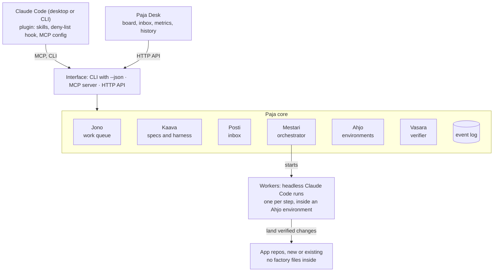

# Architecture

One headless core, Paja, with Claude Code and Paja Desk as two doors into it. The front ends never talk to each other,
only to the core, so either can be added, replaced or left out. Claude Code appears twice on purpose: once as a front
end a person types into, and once as the worker that Mestari starts on its own.

## Units

| Unit | Job | First version built with |
| --- | --- | --- |
| **Ahjo** (environments) | An isolated environment per chunk: git worktree, ports, database, services, seed data. Each one sandboxed and failing closed (no run if the sandbox can't start, hooks block when they fail), with a GitHub token that reaches only the repository being worked on | git worktrees, Docker Compose |
| **Jono** (queue and scheduler) | Work items with priority and dependencies; lease each chunk to one worker; pick the next one with plain rules; enforce a diff-size budget per chunk; pace work to the account's usage limits | GitHub issues labelled `paja`, event log |
| **Kaava** (specs and harness) | Versioned specs with acceptance criteria and a risk tier; held-out scenarios the builder never sees; an eval suite of real chunks that tests the harness itself; the domain harness and canon rules, copied into each environment as `CLAUDE.md` and skills | Markdown in the repo |
| **Mestari** (orchestrator) | Run workflow graphs: spec, plan, build, verify, review, land, post-land verify. Fix loops are capped at three rounds, after which the builder rethinks the approach instead of patching. Planner, builder, reviewer and evaluator are separate roles. A learn step after landing drafts harness rules from failures | YAML graphs; `claude -p` subprocesses |
| **Vasara** (verifier) | Load rules and scenarios from `main`, never from the branch; boot the environment and run deterministic and end-to-end checks; an independent, skeptical evaluator agent grades the running app against the acceptance criteria and held-out scenarios; after landing, re-run on `main` and revert on failure | The app's own test commands, Playwright |
| **Posti** (inbox) | Collect every agent question and escalation; send one digest, each item with options and a recommendation; mirror status to the issue | Issue comments, event log |
| Interface | One set of core functions exposed three ways, all reading from the event log | CLI (`paja ... --json`), MCP server (official Rust MCP SDK), HTTP API |
| Claude Code plugin | Skills such as `/paja-spec`, `/paja-status` and `/paja-answer`, a skill that turns a pairing session into a spec, a deny-list hook, and the MCP server config | Claude Code plugin |
| **Paja Desk** | Board of chunks, Posti inbox, outcome metrics, spend and history, usable from a phone | Web app over the HTTP API, TypeScript types generated from the core |

## State

The event log is the only store. It is append-only JSON lines in `$PAJA_HOME/events.jsonl`; every part derives its
current state by replaying it, and every write holds the home lock. See `crates/paja/src/events.rs`.

A write cut off by a crash leaves bytes after the last newline. Those were never acknowledged, so the next append
cuts them off and keeps them in `events.jsonl.torn`; a bad line that ends in a newline is an error, never repaired.

## Work queue

Jono's items are GitHub issues labelled `paja`. `paja work sync` reads the open ones with `gh` and appends
`work.imported`, `work.changed`, `work.closed` and `work.reopened` events. Whether an issue is open is kept apart from
the item's status (`queued`, `active`, `landed`, `escalated`, set with `work.status`), so an escalation's question
survives the issue closing and reopening; a landed issue that reopens is queued again. `paja work claim` takes the oldest
open, queued item and marks it active under the home lock, so two runs never share one. A sync that reads its full limit
of issues refuses to close anything rather than drop work it could not see.

## The run loop

`paja run` is Mestari's first graph. It fetches `origin/main`, syncs Jono, claims the next item and creates an Ahjo
environment `work-<issue>` from `main` (resuming the branch an earlier run kept). Then, for at most three rounds:

1. A headless `claude -p` builder implements the issue and commits. It may use only file tools, `cargo` and local git.
2. Vasara runs each command in `.paja/checks`, read from `main`. A failure goes back to the builder.
3. A fresh reviewer agent with read-only tools reads `git diff main...HEAD` cold against the issue and `CLAUDE.md` as it
   is on `main`, and answers `land`, `changes` or `escalate`. A change touching a prefix in `.paja/high-risk` (read
   from `main`) gets two reviewers, who must agree; a split is escalated.

On `land`, Mestari pushes the branch, opens a pull request, waits for CI with `gh pr checks --watch`, squash-merges it
and marks the item landed. On `escalate`, three failed rounds, a red CI or an error it can't fix, it comments on the
issue with the question and marks the item escalated; the branch keeps the work. Agents run with a throwaway
`PAJA_HOME`, so they never touch the factory's own state. Each step is recorded as `run.started`, `run.round`,
`run.landed` or `run.escalated`. `paja run --every 5` keeps going, checking an empty queue every five minutes.

## The deny-list hook

Every agent Mestari starts runs with `--setting-sources project` and settings that send each tool call to `paja hook`
as a Claude Code `PreToolUse` hook, so neither the owner's settings nor the branch's can loosen it. The hook blocks
pushing, GitHub and network commands, `sudo`, switching branches or rewriting history, publishing or installing, changes
to `PAJA_HOME`, anything touching credential paths (`~/.ssh`, `~/.config/gh` and the like), writes outside the
environment's worktree, and `rm` outside it. It splits commands at `;`, `&&`, `|` and substitutions so a denied command
can't hide behind another. It fails closed: unreadable input blocks too, and before each agent Mestari checks that the
hook blocks a `git push`, refusing to start the agent if it doesn't.

## MCP server

`paja mcp` serves the core as MCP tools over stdio (`env_*`, `work_*` and `log`), built on
the official Rust MCP SDK. Claude Code starts it from the project directory, so a tool's `repo` defaults to there. Each
tool returns the JSON the matching `paja --json` command prints, and a failure is a tool error whose text is
`{"error": "..."}`.

## CLI output

Under `--json` every command prints exactly one JSON value on stdout. Failures, usage errors included, carry an
`error` key and exit non-zero; `--help` prints `{"help": ...}` and `--version` prints `{"version": ...}`.
