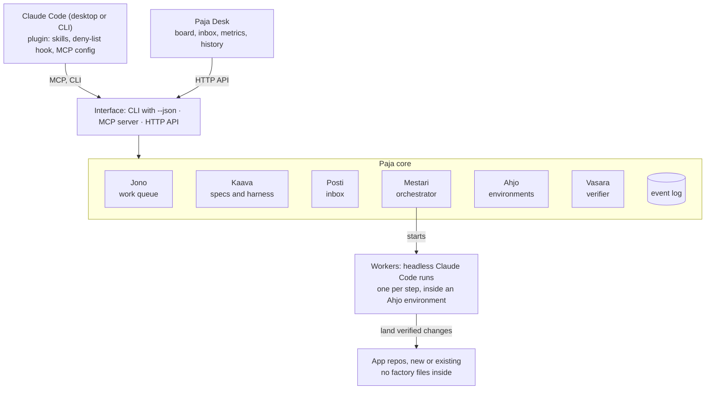

# Architecture

One headless core, Paja, with Claude Code and Paja Desk as two doors into it. The front ends never talk to each other,
only to the core, so either can be added, replaced or left out. Claude Code appears twice on purpose: once as a front
end a person types into, and once as the worker that Mestari starts on its own.

## Units

| Unit | Job | First version built with |
| --- | --- | --- |
| **Ahjo** (environments) | An isolated environment per chunk: git worktree, ports, database, services, seed data. Each one sandboxed and failing closed (no run if the sandbox can't start, hooks block when they fail), with short-lived scoped tokens under Paja's own GitHub App identity | git worktrees, Docker Compose |
| **Jono** (queue and scheduler) | Work items with priority and dependencies; lease each chunk to one worker; pick the next one with plain rules; enforce a diff-size budget per chunk; pace work to the account's usage limits | GitHub issues labelled `paja`, event log |
| **Kaava** (specs and harness) | Versioned specs with acceptance criteria and a risk tier; held-out scenarios the builder never sees; an eval suite of real chunks that tests the harness itself; the domain harness and canon rules, copied into each environment as `CLAUDE.md` and skills | Markdown in the repo |
| **Mestari** (orchestrator) | Run workflow graphs: spec, plan, build, verify, review, land, post-land verify. Fix loops are capped at three rounds, after which the builder rethinks the approach instead of patching. Planner, builder, reviewer and evaluator are separate roles. A learn step after landing drafts harness rules from failures | YAML graphs; `claude -p` subprocesses |
| **Vasara** (verifier) | Load rules and scenarios from `main`, never from the branch; boot the environment and run deterministic and end-to-end checks; an independent, skeptical evaluator agent grades the running app against the acceptance criteria and held-out scenarios; after landing, re-run on `main` and revert on failure | The app's own test commands, Playwright |
| **Posti** (inbox) | Collect every agent question and escalation; send one digest, each item with options and a recommendation; mirror status to the issue | Issue comments, event log |
| Interface | One set of core functions exposed three ways, all reading from the event log | CLI (`paja ... --json`), MCP server (official Rust MCP SDK), HTTP API |
| Claude Code plugin | Skills such as `/paja-spec`, `/paja-status` and `/paja-answer`, a skill that turns a pairing session into a spec, a deny-list hook, and the MCP server config | Claude Code plugin |
| **Paja Desk** | Board of chunks, Posti inbox, outcome metrics, spend and history, usable from a phone | Web app over the HTTP API, TypeScript types generated from the core |

## State

The event log is the only store. It is append-only JSON lines in `$PAJA_HOME/events.jsonl`; every part derives its
current state by replaying it, and every write holds the home lock. See `crates/paja/src/events.rs`.
