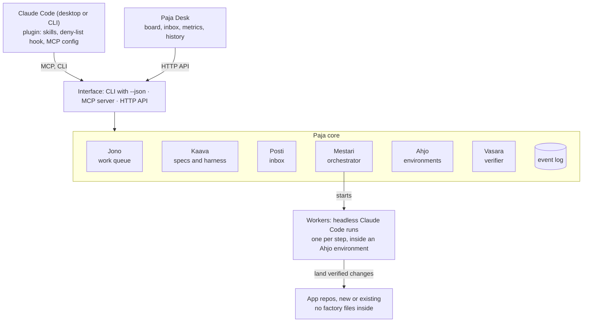

# Architecture

One headless core, Paja, with Claude Code and Paja Desk as two doors into it. The front ends never talk to each other,
only to the core, so either can be added, replaced or left out. Claude Code appears twice on purpose: once as a front
end a person types into, and once as the worker that Mestari starts on its own.

## Units

| Unit | Job | First version built with |
| --- | --- | --- |
| **Ahjo** (environments) | An isolated environment per chunk: git worktree, ports, database, services, seed data. Each one sandboxed and failing closed (no run if the sandbox can't start, hooks block when they fail), with a GitHub token that reaches only the repository being worked on | git worktrees, Docker Compose |
| **Jono** (queue and scheduler) | Work items with priority and dependencies; lease each chunk to one worker; pick the next one with plain rules; enforce a diff-size budget per chunk; pace work to the account's usage limits | GitHub issues labelled `paja`, event log |
| **Kaava** (specs and harness) | Versioned specs with acceptance criteria and a risk tier; held-out scenarios the builder never sees; an eval suite of real chunks that tests the harness itself; the domain harness and canon rules, copied into each environment as `CLAUDE.md` and skills | Markdown in the repo |
| **Mestari** (orchestrator) | Run workflow graphs: spec, plan, build, verify, review, land, post-land verify. Fix loops are capped at three rounds, after which the builder rethinks the approach instead of patching. Planner, builder, reviewer and evaluator are separate roles. A learn step after landing drafts harness rules from failures | YAML graphs; `claude -p` subprocesses |
| **Vasara** (verifier) | Load rules and scenarios from `main`, never from the branch; boot the environment and run deterministic and end-to-end checks; an independent, skeptical evaluator agent grades the running app against the acceptance criteria and held-out scenarios; after landing, re-run on `main` and revert on failure | The app's own test commands, Playwright |
| **Posti** (inbox) | Collect every agent question and escalation; send one digest, each item with options and a recommendation; mirror status to the issue | Issue comments, event log |
| Interface | One set of core functions exposed three ways, all reading from the event log | CLI (`paja ... --json`), MCP server (official Rust MCP SDK), HTTP API |
| Claude Code plugin | `plugin/`: the MCP server config (`paja mcp`) and the skills `/paja:status` (the queue, latest events, open questions), `/paja:answer` (answer an escalation and requeue it) and `/paja:spec` (turn a conversation into a `paja` issue after the person approves it). The skills change Paja's state only through its MCP tools. Agents Mestari starts load no plugins; their deny-list hook is set by Mestari itself | Claude Code plugin, installed from this repository's marketplace |
| **Paja Desk** | Board of chunks, Posti inbox, outcome metrics, spend and history, usable from a phone | Web app over the HTTP API, TypeScript types generated from the core |

## State

The event log is the only store. It is append-only JSON lines in `$PAJA_HOME/events.jsonl`; every part derives its
current state by replaying it, and every write holds the home lock. See `crates/paja/src/events.rs`.

A write cut off by a crash leaves bytes after the last newline. Those were never acknowledged, so the next append
cuts them off and keeps them in `events.jsonl.torn`; a bad line that ends in a newline is an error, never repaired.

## Work queue

Jono's items are GitHub issues labelled `paja`. `paja work sync` reads the open ones with `gh` and appends
`work.imported`, `work.changed`, `work.closed` and `work.reopened` events. Whether an issue is open is kept apart from
the item's status (`queued`, `active`, `landed`, `escalated`, set with `work.status`), so an escalation's question
survives the issue closing and reopening; a landed issue that reopens is queued again. `paja work claim` takes the oldest
open, queued item and marks it active under the home lock, so two runs never share one. A sync that reads its full limit
of issues refuses to close anything rather than drop work it could not see.

`paja work answer <issue> <text>` records a person's answer to an escalated item (`work.answered`, with the question it
answers) and queues the item again under the home lock, then posts the answer as a comment on the issue. Each item
keeps its `answers`, and every later run passes them to the builder and the reviewers, since agents can't read the
issue's comments; a reply on the issue alone doesn't reach them, and Paja's question on the issue says so. For the
same reason `paja work set <issue> queued` refuses an escalated item and points at `paja work answer`; it is the only
way an escalated item is queued again. Setting it `active` and then `queued` by hand still works, as a deliberate
escape hatch for an item that needs no answer.
`paja work file --title --body` opens a new issue labelled `paja`. Both use `gh`, and the MCP tools `work_answer` and
`work_file` do the same.

## The run loop

`paja run` is Mestari's first graph. It fetches `origin/main`, syncs Jono, reads `.paja/checks`, `.paja/high-risk`
and `.paja/models` from `main` and checks them, claims the next item and creates an Ahjo environment `work-<issue>`
from `main` (resuming the branch an earlier run kept). A mistake in that configuration stops the pass before it
claims anything, with an error naming the file and line, so one fix on `main` is all it takes; a `--every` loop
reports it and tries again after its wait. While it works on an item the run holds an OS file lock,
`runs/<issue>.lock` in the home, which the operating system releases however the process ends. An item a `paja run`
claimed (its status change carries `"run": true`) that is still `active` while its lock is free was left by a run that
stopped (Ctrl-C, a closed terminal, a reboot): the next pass resumes it first, in its `work-<issue>` environment, and
says so on stderr. Items claimed with `paja work claim` are never taken over. Then, for at most three rounds:

1. A headless `claude -p` builder implements the issue and commits. It may use only file tools, `cargo` and local git.
   A fix round (after failed checks, a `changes` verdict or a round with no commits) resumes the builder's own
   session from earlier in the same run with `--resume <session_id>` and sends only the feedback, so it keeps what it
   learned and its earlier turns come from the prompt cache. It runs with the same flags and hook as any session. When
   there is no session from this run (a new `paja run`, so a recreated environment too) or resuming fails, it starts a
   fresh session with the whole issue and says so in a progress line; the failed attempt's spend is recorded as a
   step of its own. A resume that fails on a usage or rate limit (`api_error_status` 429) or a refused sign-in (401,
   403) is not retried, since a fresh session would fail the same way: the run stops with an error that says what to
   do, and that attempt's spend is recorded too. Reviewers never resume: each review is a fresh session reading cold.
   A resumed step records `resumed: true` and only its own share of the session's running `total_cost_usd` and
   `modelUsage`. When the issue leaves a decision only the person can make, the builder commits
   nothing and ends its final message with a line starting `PAJA-QUESTION:`, followed by the question, the options
   and its recommendation. Mestari then escalates at once with that question: no checks run and no more rounds are
   spent, and the round is recorded with verdict `question`.
2. Vasara runs each command in `.paja/checks`, read from `main`. A failure goes back to the builder, and so does a
   check run that changed the worktree, its index or its commits, which are put back first. The checks start from a
   fresh index, so the only assume-unchanged or skip-worktree flags left are the ones sparse checkout gives; a check
   run that changes those flags changed the index.
3. A fresh reviewer agent reads `git diff main...HEAD` cold against the issue and `CLAUDE.md` as it is on `main`, and
   answers `land`, `changes` (blockers only) or `escalate`, plus non-blocking follow-ups that Mestari files as
   `paja-follow-up` issues once the change lands. A later round's reviewer judges only the fix for the earlier
   blockers, except on high-risk changes. It may read, run cargo and use read-only git, and changes nothing. Its prompt names the commit Vasara's checks
   passed at, the one it judges, and tells it not to re-run formatting, lints or the full test suite; to probe a
   behaviour it runs one named test or the CLI, with long output piped through `tail` or `grep`. A change
   touching a path in `.paja/high-risk` (read from `main`) gets two reviewers, who must agree; a split is escalated.
   An entry matches as a prefix, and an entry that is a single name (`.cargo/`, `CLAUDE.md`) also matches that name,
   or the name with an extension, at any depth, in any letter case.

Each agent runs on the model `.paja/models` names for its role, read from `main` like the checks, so a change can't
pick the models that judge it. One line per role, `role model [effort]`, with `#` comment lines: `build` (the first
build round), `fix` (later build rounds), `review` (the first full review), `re-review` (a normal-risk review of only
the fix) and `review-2` (the second high-risk reviewer). Mestari passes `--model` and, when given, `--effort`; a role
with no line passes neither and runs on the account's default. A `fallback <model>` line adds `--fallback-model`
(left out where it is the role's own model), so a busy model doesn't fail the round. An unknown role, effort or a
malformed line stops the run with an error naming the line. Each recorded step names its `role` and `model`.

Every session also gets `--max-turns`, from `max-turns <role> <turns>` lines in the same file (80 for `build` and
`fix`, 30 for the reviews when a role has no line), so an agent going in circles can't spend the account's usage
window. A session that stops at its limit fails the round with a note (`turn_limit`, "the builder hit the turn limit
of 80") and its spend is still recorded. The builder's next round is told to finish smaller. A reviewer that hits the
limit first runs once more in the same round, in a fresh session told to stay focused, and the other reviewer's
finished verdict is kept. If it hits the limit again, its worktree is put back as after any review, the round fails and
the builder is told to make the change easier to review. The same kind of step (build or review) failing a round on
its limit a second time in a run escalates with a question that says so, instead of using another round.

On `land`, Mestari pushes the exact commit the checks and reviewers judged as the branch, opens a pull request, waits
for CI with `gh pr checks --watch`, squash-merges it and marks the item landed. On `escalate`, three failed rounds, a
red CI or an error it can't fix, it comments on the issue with the question and marks the item escalated; the branch
keeps the work. Agents run with a throwaway `PAJA_HOME`, so they never touch the factory's own state. Each step is
recorded as `run.started`, `run.round`, `run.landed` or `run.escalated`, plus a `run.follow_up` for each non-blocking
review finding. Each `run.round` event also lists the round's agent steps under `steps`: which step (`build`, or
`review` with its `reviewer` number), the models used (Claude Code's `modelUsage`), the input, output, cache-read and
cache-creation tokens, the estimated `cost_usd`, `num_turns`, `duration_ms` and `session_id` from the `claude -p`
result. A round that stops on an error still records the steps that already ran, as a `run.round` with verdict
`error` and the error as its detail, before the item is parked. A field the result lacks is `null`, never zero, and
rounds recorded before steps were kept have none. Replaying
those events gives each work item a `usage` total (null until a step is recorded) in `paja work` JSON and the matching
MCP tools; steps with missing fields count in its `unknown_steps` and add nothing, and so does a recorded step Jono can't read,
so a bad usage record never stops the queue. While it works, `paja run` prints one progress line per step on stderr (the issue it picked, each build
round, the checks, each review and its verdict, waiting for CI, landed or asked, and with `--every` each wait), so
stdout keeps its JSON. `paja run --every 5` keeps going, checking an empty queue every five minutes.

## The deny-list hook

Every agent Mestari starts runs with `--setting-sources ""`, `--strict-mcp-config`, `--tools` naming only the
built-in tools its role uses (`Read,Edit,Write,Glob,Grep,Bash` for builders, `Read,Glob,Grep,Bash` for reviewers, so
no subagent or web tool is defined at all), `--exclude-dynamic-system-prompt-sections` (the worktree's path and git
status go in the first message, so sessions in different environments share a cached prompt prefix) and settings that send each tool
call to `paja hook --root <environment> --home <factory home>` as a Claude Code `PreToolUse` hook. No settings file
and no MCP server is loaded, so neither the owner's settings nor a file on the branch can loosen the hook or switch it
off. Because that also skips `CLAUDE.md`, Mestari passes main's `CLAUDE.md` with `--append-system-prompt`, so the
branch under review can't rewrite the rules its builder and reviewers follow. The bounds are passed in rather than read
from the tool call, because the reported `cwd` moves when the agent runs `cd`.

- **Tools** are allowed by name: the file tools, Bash, and harmless ones such as `TodoWrite`. Any other tool, MCP
  tools included, is blocked. Subagents run in the same worktree in the foreground, under the same hook; one with
  `isolation` or `run_in_background` is blocked, since Claude Code would make its worktree without a call to judge.
- **Shell commands** must have one plain shape, because a shell has too many ways to hide a command: an optional
  `cd` to the worktree's root as a step of its own (an absolute path with no `.` or `..` parts, since bash's `cd`
  drops `..` as text before following links), then `cargo`, local `git` and `pwd` commands joined by `&&`, each
  optionally piped into `head`, `tail`, `grep` or `wc` with no file arguments. No `$`, backticks, globs, a leading `~`
  or `=`, redirections other than `2>&1`, or other separators outside single quotes. Only `RUST_BACKTRACE` and
  `RUST_LOG` may be set in front of a command.
- **Cargo and git flags** come from a list per subcommand, and anything not on it is blocked, so no spelling of an
  option can load other configuration, run a program or reach another file. Cargo runs build, check, test, fmt,
  clippy, run and doc, with plain names for packages, targets, test filters and lints. Git's subcommand comes first
  (so no `-C` or `-c`) and is one of add, commit, status, diff, show, log and rm; not `stash`, whose refs every
  checkout shares. Its revisions and paths must stay inside the worktree. `cargo fmt` takes options only with
  `--check`, since `--all` and `-p` can reach path dependencies outside the worktree.
- **Writes** stay in the environment: file edits and git's paths must resolve inside the root, with symlinks followed,
  and never into a `.git`, `.cargo`, `.github` or `.claude` directory, a `rust-toolchain` or `.gitattributes` file or
  a rustfmt or clippy configuration file at any depth, in any letter case (reading them is fine). A file tool path may
  not hold `..`. `git rm` takes plain files only, and `git commit` needs `-m`. These rules cover paths an agent names;
  a file its code writes can still be staged by `git add -A`, and then makes the change high risk.
- **Reads** of single files outside the worktree are limited to `/usr` and dependency sources (`$CARGO_HOME/registry`,
  `$CARGO_HOME/git` and `$RUSTUP_HOME`, from the hook's own environment); never `/proc`, `/sys`, `/dev`, other hidden
  directories or the factory home. Searches (`Glob`, `Grep`, `LS`) recurse, so they stay inside the worktree, symlinks
  followed, and are blocked while the worktree holds a symlink out of the worktree. To keep that scan fast, a `Grep`
  without a `glob` leaves out the worktree's top-level `target` directory, which ripgrep never enters either, when the
  worktree's `.gitignore` names it in a line git and ripgrep read the same way (`target`, `target/`, `/target`,
  `/target/`). Git and ripgrep match ignore patterns with different engines, so no other directory is left out, and
  git is not asked. `target` itself is still checked for being a link out. Nothing is left out when any of these
  could make ripgrep search it after all: a `!` line in that `.gitignore` or in one above the worktree, a ripgrep
  ignore file (`.ignore`, `.rgignore`) in the worktree's top directory or above it, `RIPGREP_CONFIG_PATH`, a worktree
  without `.git`, a `.gitignore` that isn't all UTF-8 (ripgrep stops reading at the first bad line) or that is over 4
  KiB or holds anything but comments, names and `*`/`?` (ripgrep drops a file it can't compile), a search that
  starts inside `target`, or a symlink into it. `Glob`, `LS` and a `Grep` with a `glob` always walk the whole
  worktree. These conditions follow how ripgrep reads ignore files, so a ripgrep change means checking them again. They
  also assume that Claude Code's `Grep` runs ripgrep with its default ignore handling (no `--no-ignore`, `-u` or
  `--ignore-file`) and in the hook's environment, which is where `RIPGREP_CONFIG_PATH` is read. A `.gitignore` is read
  only up to 4 KiB; a bigger one leaves nothing out. A file tool path may not start with `~`, a search pattern may not
  hold `..` or a path inside braces, and no tool may name a credential path (`.ssh`, `.config/gh` and the like).
- **Network tools** (`WebFetch`, `WebSearch`) are blocked.
- **On Windows** the same rules apply to Windows spellings, and paths the file system reads differently from how they
  look are refused rather than interpreted: device and UNC paths (`\\?\`, `\\server\share`), drive-relative
  (`C:foo`) and drive-less rooted paths (`\x`), names ending in a dot or space (`.git.` is `.git`), alternate data
  streams (`a:stream`), reserved device names (`NUL`, `COM1`) and characters Windows forbids in names. Names and
  credential paths compare without case and with `\` as a separator. A `cd` may name the root as `C:\...` or in Git
  Bash's `/c/...` form. Search patterns use `/` and stay relative. Junctions count as symlinks. Reads outside the
  worktree are limited to dependency sources (there is no `/usr`). Paja's scratch and stamp directories are created
  with a protected, owner-only ACL in one step (no window where the parent's applies), and the factory's hook
  directory is created that way or, if it exists, checked before every run to be owned by this user and closed to
  everyone else. Keep `PAJA_HOME` under the user profile (the default), so nobody else can rename the hook directory
  away. Hook command lines are quoted so `cmd.exe`, which Claude Code uses for
  hooks on Windows, and Git Bash read them the same way.

It fails closed: unreadable input, missing bounds, a crash and running past its own 20-second deadline all block, and
the hook command ends in `|| exit 2` so a binary that can't start or is killed blocks too. Claude Code's own hook
timeout is set well above that deadline. The hook runs from a copy of the paja binary in the factory home, so an agent's
`cargo build` can't replace the binary that judges it; Mestari uses the copy only while it matches the running binary
byte for byte, and writes it again otherwise. Managed settings still load, so Mestari refuses to start agents when they
set `disableAllHooks` or `allowManagedHooksOnly`. Policy can arrive in other ways too, so the hook also touches a stamp
file on every call: an agent run that took more than one turn or changed the worktree without one is rejected, and its
branch is reset to where the run started. Only the two managed-settings locations (each file and its
`managed-settings.d` drop-ins) are checked up front. The stamp catches a hook that was silently dropped, not an agent
that forges it while hooks are off; containing that is the sandbox's job. Before each agent Mestari checks that the hook
blocks a `git push` (for a reviewer, a local `git commit`) with the deny-list's message and allows `cargo test`, and
refuses to start the agent if not. The hook is a guardrail, not a sandbox: code the agent writes still runs under `cargo
test`. Mestari takes away the easy ways that code could reach GitHub: agents run without GitHub or registry tokens, the
SSH agent or askpass programs, with gh's login, git's global and system configuration and every credential helper
switched off, and with the owner's commit name, email and global ignore file passed in instead. Vasara's checks run the
same branch code, so they run with the same environment. Agents and checks keep the owner's `HOME`, which Claude Code
needs to sign in and toolchain managers use to find cargo, so code they run can still read credential files there (such
as `.netrc` or cargo's `credentials.toml`), and a token written into the remote's URL is not covered: closing those is
the sandbox's job. That code could also change the git configuration, hooks or attributes the worktree shares with the
repository, to make Mestari's own git run a program with Mestari's credentials. So Paja's own git never runs hooks or a
file-system monitor, and no git Paja starts honours replacement refs or grafts, and Mestari snapshots those files, and
the owner's global git configuration, before each agent and check run. Those files include every file git reads
configuration from and the worktree's links to the repository. If they changed, it parks the item, records
`run.tampered` and stops with an error naming the changed files (a `--every` loop included) without running git or gh
there again, not even to clean up or comment on the issue. The guard also notices another environment's links and
configuration changing. Until a person has checked that repository (found by its shared git directory, however its
path is spelled) and runs `paja run --tamper-checked`, every command and MCP tool that runs git or gh there refuses:
later runs, `work sync`, `env create` and `env remove`. The check lives in Ahjo, so a new command gets it by calling
`ahjo::ensure_untampered` before its first git or gh. Configuration files are compared by
the entries git reads, leaving out `branch.*`, which ordinary git work writes; every other file byte for byte. The
hook's copy is checked again after each agent run, and a copy that changed counts as a run the hook never saw. Each
phase takes its own snapshot, so a change made between phases (by a process the code left running, say) is not caught,
nor is a relative include resolved against a file other than the repository's or the owner's main configuration. The
guardrail's limit stays: code that runs as the owner can still change things none of these checks look at, and only the
sandbox closes that. Reviewers run the hook with `--read-only`: no file edits, no `cargo fmt` without `--check` and no
git command that changes the branch; after the review, the branch and worktree are put back where it started, whatever
the code its builds ran did. Because no settings file loads, agents authenticate the way `claude` does without one (a
signed-in subscription or `ANTHROPIC_API_KEY`), not through `apiKeyHelper` or provider settings.

The limits above (credential files in `HOME`, the shared git configuration, the hook's copy, the stamp) are what the
sandbox below closes when it is on.

### The sandbox

The sandbox is optional and off by default. It is a [Docker Sandboxes](https://docs.docker.com/ai/sandboxes/) (`sbx`)
backend: set `PAJA_SBX` to the `sbx` program (`PAJA_SBX=sbx`) and `paja run` runs every agent session and every
check command of Vasara inside one long-lived sandbox named `paja`, which every run reuses. A run reuses it only when
the directories it needs are mounted in it; otherwise it stops and says to remove the sandbox (`sbx rm paja`) so the
next run creates it again. Toolchain setup waits (about five minutes) for apt's locks, which a new sandbox holds
while it starts.

- **What the code can reach.** Only what is mounted: the factory's `envs/` directory (the worktrees) and the
  repository's own `.git` directory, which commits in a worktree need. The owner's `HOME`, its credential files, git's
  global and system configuration, the factory's event log, the hook's copy of the binary and the stamp are not in the
  sandbox. Code in it gets a throwaway `PAJA_HOME` in the sandbox's own `/tmp` and the same stripped git environment as
  on the host, and none of the host's environment variables.
- **Fail closed.** `paja run` starts (creating, if needed) the sandbox before it touches the queue. If `PAJA_SBX` is
  set and the sandbox can't start, it stops with an error that says what to install or set up. It never falls back to
  running on the host. Without `PAJA_SBX`, `paja run` says on stderr that there is no sandbox, and runs as described
  above, behind the deny-list hook only. Detection is optional by design: Paja has no Docker dependency, and its tests
  use a fake `sbx`.
- **Permissions.** Claude Code is always started with `--permission-mode auto` in the sandbox; the sandbox image's
  default, `bypassPermissions`, is never used. The deny-list hook is a host program and does not run in the sandbox, so
  there the sandbox is the guard; `--allowedTools`, GitGuard and the reset after a review still apply.
- **Toolchain.** Vasara's checks need Rust and a C compiler. On first start Paja checks for `cc`, `cargo` and `rustfmt`
  in the sandbox and installs what is missing (`build-essential` through `apt`, Rust through rustup, minimal profile
  with `rustfmt` and `clippy`). If that fails, the error says to open `sbx exec -it paja sh` and install them by hand.
- **Signing in.** Sign in once, inside the sandbox: `sbx exec -it paja claude`, then `/login`. When Claude Code in the
  sandbox reports it is not signed in, the item is parked with that command in the question, rather than failing as a
  check.
- **Why `sbx`.** Docker Sandboxes gives each sandbox a micro-VM with its own kernel, and works on Windows Home and Pro,
  macOS and Linux with one installer and no administrator account setup. A dedicated low-privilege user with ACLs, an
  AppContainer or a restricted token each need per-machine administrator setup on Windows that differs between Home
  and Pro, and none of them hides the owner's files from a process the way a separate VM does; bubblewrap and
  `sandbox-exec` don't exist on every platform Paja runs on. So Paja has one backend, and the owner opts in.
- **Assumptions about `sbx`.** Everything Paja assumes about it is in `crates/paja/src/sandbox.rs`: `sbx exec`
  with `-w`, `-e` and `--`, `sbx create --name NAME claude PATH...`, and that a mounted path has the same absolute
  path inside the sandbox.
- **Still open.** The sandbox covers only what Paja starts inside it: Paja's own git and `gh` run on the host with
  Mestari's credentials, so GitGuard still watches the shared git files, which the sandbox mounts read-write. The
  other worktrees under `envs/` are mounted too, so code in one worktree can reach another.

## MCP server

`paja mcp` serves the core as MCP tools over stdio (`env_*`, `work_*` and `log`), built on
the official Rust MCP SDK. Claude Code starts it from the project directory, so a tool's `repo` defaults to there. Each
tool returns the JSON the matching `paja --json` command prints, and a failure is a tool error whose text is
`{"error": "..."}`.

## CLI output

Under `--json` every command prints exactly one JSON value on stdout. Failures, usage errors included, carry an
`error` key and exit non-zero; `--help` prints `{"help": ...}` and `--version` prints `{"version": ...}`.
