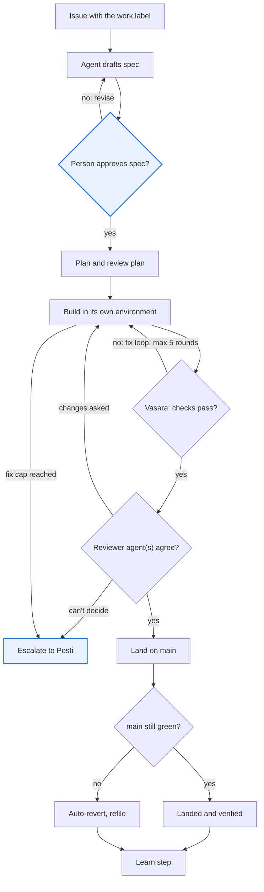

# How one piece of work flows

A chunk starts as a GitHub issue and ends as verified code on `main`. People are involved in only two places: approving
the spec, and answering escalations when the automated gates can't decide. Everything between spec approval and a
green `main` is one Mestari graph, with each step a fresh headless Claude Code run in its own Ahjo environment.

The issue is usually one with the work label. When no such item is ready, `paja run` takes the oldest open issue with
the follow-up label instead (issues people filed; Mestari files none), and it goes through the same loop,
risk tier and `Depends on` rules. Work items always come first: a work item that becomes ready is picked before any
follow-up at the next pick. `follow-ups = off` in `.paja/queue` on the default branch turns this off.

## Triage of follow-ups

Follow-up issues go stale: later changes fix them, repeat them or make them moot. `paja triage` (and the MCP tool
`triage`, which returns the same JSON) keeps the list short. One agent on the `triage` role in `.paja/models` (the
cheapest model; a repository with no line runs it on the account's default) reads the open issues with the follow-up
label, up to 60, and sorts each into one of the verdicts below. Each issue gets a turn: a pass reads first the issues no
pass has read (oldest first), then those whose last read (in `triage.ran`) is longest ago, so a list longer than 60 is
read in full over a few passes. The next 200 open follow-ups past the 60 are listed too, by number and title only, so an
issue of the pass can be called a duplicate of one a later pass reads. Issue text is data in the prompt: its angle
brackets, and brackets that look like them, become `‹` and `›`, so it can't open or close one of the prompt's tags or
seem to, and characters that render as nothing (format characters and the other default-ignorable code points, such as
variation selectors and Hangul fillers, and the braille blank) are dropped. The prompt tells the agent that `‹` and `›`
stand for any angle bracket. The verdicts:

- `keep`: still valid. Also what anything Paja can't back up becomes.
- `duplicate`: the same as another open follow-up issue, which it names.
- `already_fixed`: the default branch already fixes it, with a commit on that branch or a file there that shows it.
- `not_worth_doing`: valid but not worth the effort, with the reason.

Duplicates and already-fixed issues are closed with a comment that gives the reason and the evidence. A duplicate's
original also gets a comment naming the closed issue, so if the original is later closed without being done, the
duplicate's finding can be found and reopened. If that note fails, the item stays closed with the note's failure as its
`error`, the pass records it in `triage.ran` as `note_failed`, and the next pass tries it again (`retried_notes` in the
report). Retries run before the agent and are recorded at once as `triage.notes` (`noted`, `note_failed`), so a pass
whose agent fails still makes them and never posts them twice; a failed retry is also written to stderr. A duplicate
closed again in a pass that retries its note gets no second note. After three passes fail the same note, Paja gives up
on it, and the last failure's error says to add the comment by hand. "Not worth doing" is never closed: the report lists
it, and the person decides. An issue that also has the work label is a work item and
is left out.

The agent reads the default branch only, in a checkout made from it for the pass, under the deny-list hook with
read-only tools, like a reviewer. The checkout is an Ahjo environment named like a work item's (`<repo>-<hash>-triage`),
so each repository has its own and an environment a person made is never reused or removed. One pass runs per
repository at a time: a pass holds a lock for its whole life, a second `paja triage` (or MCP call) fails while it is
held and says to wait, and `paja run --every` and an idle pool skip their pass then. Its word is not enough to close anything: Paja closes a duplicate only when the
original is another open issue that stays open, and an already-fixed issue only when the evidence has to do with it: a
named commit must be on the default branch, committed after the issue was opened, and change a file the issue names
(a merge against its first parent; in a shallow clone a commit with no parent there is not taken), and a named file must exist there and be named in the issue's title or body. A path the issue gives names that path (or
a longer or shorter one ending in it at a `/`), and a bare file name with an extension names any file of that name;
paths use `/` whichever way the agent wrote them. A link to one of the repository's own files on GitHub
(`.../<owner>/<name>/blob/<ref>/<path>`) names that path; any other link names nothing. Otherwise the issue is kept. Each issue reaches the agent with when
it was opened. Issue text reaches the agent as data to judge.

`--json` prints `{repo, base, items, closed, not_worth_doing}`, and `retried_notes` when a pass tried earlier notes
again; each item has its `verdict`, `reason`, `duplicate_of` or
`evidence` when it has one, and `closed` (or the `error` that stopped a close). Each pass is recorded as `triage.ran`
with what was closed, kept and left for the person.

`paja run --every` triages at most once a day, when a pass finds the queue idle. It reads `triage.ran` (and
`triage.failed`, recorded when a pass fails, so a broken pass isn't retried every few minutes) to know when the last
one ran, and prints one more JSON line, `{"outcome": "triage", "triage": {...}}`, when it triaged. An idle
`paja run --workers` pool does the same, and tags a failed pass's error line as well (`{"outcome": "triage", "error":
"..."}`), so it can't be read as a lane's. With follow-ups
taken as work (the default), the queue is idle only once they are done, so a repository that wants stale ones closed
before they are built sets `follow-ups = off` in `.paja/queue` or runs `paja triage` itself.

After landing, the learn step turns any revert, escalation or human fix into a proposed harness rule or check. It is
adopted when the eval suite shows it helps, and it appears in the next Posti digest.
